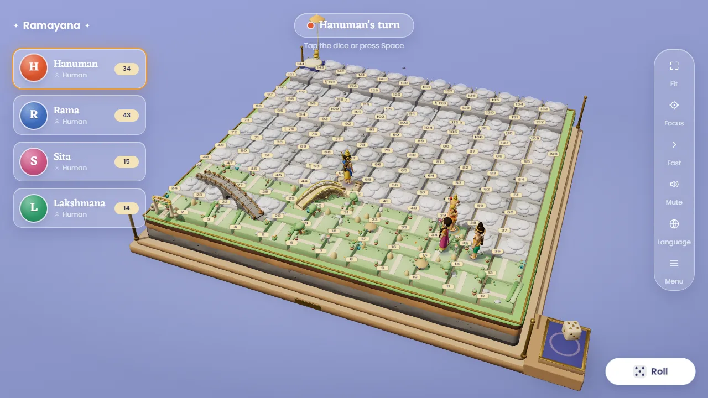

# Ramayana Snakes & Ladders

Snakes & Ladders, retold through the Ramayana. Every ladder and every snake is a moment from the epic, so the board tells the story from Ayodhya's gate, through the forest and across to Lanka, and back to Ayodhya's throne at square 144. The board is a 3D diorama you can turn and zoom: a 12 × 12 field of land blocks on an oak plinth, hidden under fog until a hero walks onto it. Ladders are stone bridges that rise out of the ground, and snakes coil up from their square when someone lands on them. Four heroes play it, each with their own voice and feelings, in English or Hindi. It is built with TypeScript, React and three.js (React Three Fiber).

## Play

**https://aimedtechgeek.github.io/ramayana-snakes-ladders/**

The link goes live once GitHub Pages is enabled for the repository (see [Deploying](#deploying)). Until then, run the game locally with `npm run dev`.

New to the game? Read the illustrated [player guide](docs/USER_GUIDE.md). Joining as a developer? Start with the [architecture overview](docs/ARCHITECTURE.md).

## Features

- Two to four seats, each Human, Bot or Empty, with a choice of hero for each seat.
- Three board levels (Easy, Medium, Hard). Each level uses the same story map with a different mix of ladders and snakes.
- A story-ordered board of 9 ladders and 13 snakes, each named after a Ramayana event.
- A 3D board in story regions (Mithila, Ayodhya, the Dandaka forest with the Ganga, Kishkindha, the sea and Lanka), with trees, huts, animals and landmarks, Ayodhya's gate by square 1, and the coronation dais and royal parasol on square 144.
- Fog of war: the board is hidden until a hero reaches it, and each snake and bridge stays hidden until someone lands on it.
- Ladders are arched stone bridges that the heroes run across (Hanuman jumps from 95 to 122 in one leap). Snakes rise from their square, swallow the hero and let them out at the tail.
- Four animated 3D heroes (Rama, Sita, Lakshmana and Hanuman) who walk, run, leap and react to every move with gestures and speech, in English and Hindi.
- A 3D die that you roll in its tray at the edge of the board.
- A camera you control: turn, zoom and move with the mouse, touch or keyboard, with Fit and Focus buttons.
- Autosave: close the window and resume where you stopped.
- Sound made in the browser with the Web Audio API, with Mute, and a Fast mode.
- Support for the system's reduced-motion setting, and a layout for laptops, tablets and phones in landscape.
- No accounts, and no game data leaves the device.

## Development

Requires Node.js 22 (see `.nvmrc`).

| Command                         | What it does                                                                                       |
| ------------------------------- | -------------------------------------------------------------------------------------------------- |
| `npm install`                   | Install dependencies.                                                                              |
| `npm run dev`                   | Start the Vite development server.                                                                 |
| `npm run build`                 | Type-check and build the game into `dist/`.                                                        |
| `npm run preview`               | Serve the last build on port 4173.                                                                 |
| `npm test`                      | Run the unit tests (Vitest), including the checks on the built 3D models.                          |
| `npm run lint`                  | Run ESLint.                                                                                        |
| `npm run sim`                   | Simulate many games with the real rules engine and check the balance thresholds.                   |
| `npm run verify`                | Run the full check: lint, tests, simulation, build and smoke test.                                 |
| `npm run smoke`                 | Serve the last build, play it in Microsoft Edge, fail on any error or on a performance budget.     |
| `npm run devices`               | Check the canvas fit, errors and frame rate at five device sizes.                                  |
| `npm run screenshots`           | Regenerate the images in `docs/images/` (run `npm run build` first).                               |
| `npm run blender:board`         | Rebuild the board (plinth, soil, blocks) with headless Blender 5.2.                                |
| `npm run blender:props`         | Rebuild the props and landmarks, and their manifest.                                               |
| `npm run blender:heroes`        | Rebuild the four rigged heroes and their nine animation clips each.                                |
| `npm run blender:snakes`        | Rebuild the 13 snakes and their manifest.                                                          |
| `npm run blender:bridges`       | Rebuild the 9 stone bridges and their manifest.                                                    |
| `npm run blender:dice`          | Rebuild the die and its tray.                                                                      |
| `npm run blender:heroes:check`  | Turntables, clip sheets, foot-drift and frame-rate checks of the heroes (needs `npx vite --port 5311`). |
| `node scripts/review/*.mjs`     | Review captures, performance numbers and full bot games for a review pack (see `docs/review/`).    |

Blender is found through the `BLENDER` environment variable or its default Windows install path (`scripts/blender/run.mjs`).

## Project structure

| Path                  | Contents                                                                                                       |
| --------------------- | -------------------------------------------------------------------------------------------------------------- |
| `src/core/`           | Rules engine, boards, dice and events. Plain TypeScript with no renderer, so it is unit tested.                |
| `src/app/turn/`       | The TurnController, which plays each turn, and the ports it drives (`BoardView`, `HudSink`).                    |
| `src/app/board3d/`    | The 3D diorama: the board, fog, props, heroes, snakes, bridges, die, camera and lighting (React Three Fiber). |
| `src/app/hud/`        | The heads-up display over the board: seat cards, turn banner, speech bubbles, and the store behind them.       |
| `src/app/screens/`    | React screens: Boot, Setup, Game, Gallery, and the Menu, Win and Rotate dialogs.                               |
| `src/app/ui/`         | Shared buttons, pills, dialogs, icons and toasts.                                                              |
| `src/game/`           | Fog-of-war reveal, autosave, locomotion and block rules, setup model, heroes and audio.                       |
| `src/characters/`     | Reactions and how engine events map to them.                                                                   |
| `src/i18n/`           | English and Hindi strings.                                                                                     |
| `sim/`                | Monte Carlo simulator that drives the real rules engine.                                                       |
| `scripts/`            | Smoke, device and screenshot checks, review captures, and the Blender model builds (`scripts/blender/`).      |
| `public/models/`      | 3D models (GLB): board, props, landmarks, die, the four heroes, snakes and bridges.                            |
| `public/fonts/`       | The self-hosted fonts and their licences.                                                                      |
| `tests/`              | Unit tests.                                                                                                    |
| `docs/ARCHITECTURE.md` | How the code fits together: modules, turn flow, scene graph, assets, budgets and tests.                       |
| `docs/design/`        | Design documents: heroes, style guide, board art, UX, emotion timing, and the T40 to T44 specs.                |
| `docs/review/`        | Review and playtest notes, with their captures.                                                                |
| `docs/images/`        | Screenshots used by this README and the player guide.                                                          |

## How it was built

The game was built in milestones:

| Milestone           | What it delivered                                                                                                    |
| ------------------- | -------------------------------------------------------------------------------------------------------------------- |
| M0 Design           | Hero personalities, style guide, board art, UX and emotion timing (`docs/design/`).                                  |
| M1 Core             | The rules engine, story-ordered boards, the simulator and continuous integration.                                    |
| M2 Playable         | Setup, board, dice, bots, autosave, and the win and rotate overlays.                                                 |
| M3 Alive            | Character reactions, speech bubbles, derived events, and English and Hindi.                                          |
| M4 Art              | The vector board, tokens, snake heads, themed ladders and credits.                                                   |
| M5 Polish           | Sound effects and drone, visual effects, device checks, and a respect-rules review.                                  |
| T40 Anatomy         | A 2D isometric redesign of the board as a crafted object, with a Hanuman figurine.                                   |
| T41 Camera          | A shared isometric camera and board projection.                                                                      |
| T42 Living board    | Region blocks, fog of war, a zoomable camera, standing snakes and stone bridges, still in 2D.                        |
| T43 Walking Hanuman | An articulated Hanuman that walks, runs and leaps along the board.                                                   |
| T44 3D diorama      | The game rebuilt in 3D with React Three Fiber: a Blender-built board, props, four rigged heroes, 13 snakes, 9 bridges and a die; the glass UI; the player's camera; and performance budgets. The 2D art and Phaser were removed. |

The rules engine, the fog-of-war reveal, the save format, the locomotion timing and the block rules carried over from the 2D game.

The project was built with Claude models (Anthropic): design by Fable, complex logic by Opus, and simpler tasks by Sonnet and Haiku. The repository owner reviewed the work.

## Credits and licence

- The game is released under the MIT licence. See [LICENSE](LICENSE).
- [CREDITS.md](CREDITS.md) lists the 3D models, the fonts (Rozha One, Eczar and Poppins, under the SIL Open Font License, served with the game), the software and the note on the Ramayana story.

## Deploying

The game is deployed to GitHub Pages by `.github/workflows/deploy.yml`.

1. In the GitHub repo, go to Settings → Pages and set Source to "GitHub Actions", then add the repository variable `DEPLOY_PAGES` = `true` (Settings → Secrets and variables → Actions → Variables). Until then CI runs every check but skips the deploy job.
2. Every push to `main` runs lint, test, sim and build, then deploys to https://aimedtechgeek.github.io/ramayana-snakes-ladders/ . Pull requests run the same checks but do not deploy.
3. To deploy another branch, open Actions → Deploy → Run workflow and pick the branch. The run deploys only if the `github-pages` environment allows that branch (Settings → Environments → github-pages → Deployment branches); by default only `main` is allowed. A manual deploy replaces whatever is live until the next push to `main`.
4. The build uses `base: './'` (see `vite.config.ts`), so it works under the repo sub-path.

CI does not run the browser checks (`npm run smoke`, `npm run devices`); run `npm run verify` locally before you push.
