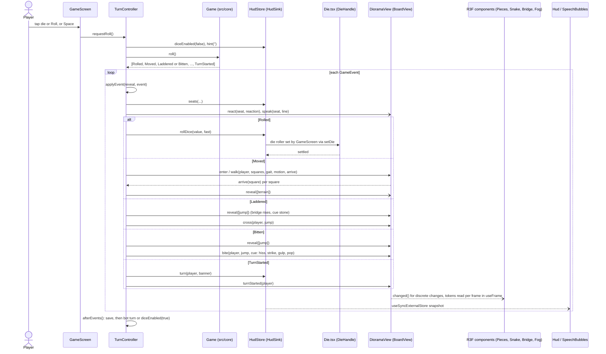
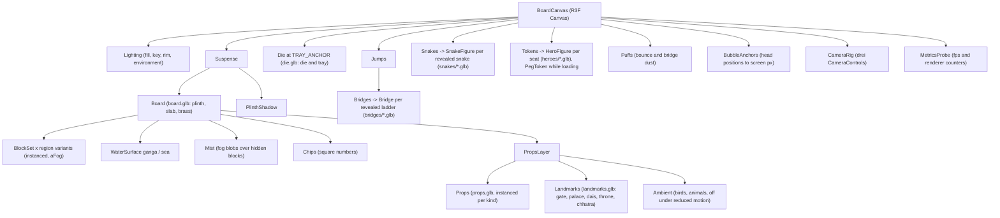

# Architecture

This document is for a developer joining the project. It explains how the code is split, how one turn travels from a
die roll to the next turn, how the 3D scene is put together, who owns which state, how the 3D assets are made, and how
the game is tested and deployed. Every file and function named here exists in the code; when this document and a
design spec disagree, the code is right (see [Specs and review packs](#specs-and-review-packs)).

## 1. Overview

The game is a single-page web app: TypeScript, React 19, three.js through React Three Fiber (R3F) and drei, built with
Vite. It has three layers:

1. **A renderer-free rules engine** (`src/core/`). `Game` takes a roll and returns a list of `GameEvent`s
   (`Rolled`, `Moved`, `Laddered`, `Bitten`, `Won`, ...). It knows nothing about screens, React or three.js.
2. **A turn controller** (`src/app/turn/TurnController.ts`). It plays those events in order through two ports, a
   `BoardView` and a `HudSink` (`src/app/turn/ports.ts`), lifts the fog, starts the heroes' reactions, saves, and rolls
   for bots. It imports no React, three.js or DOM types, so it is unit tested with fakes.
3. **The presentation**: `DioramaView` (`src/app/board3d/DioramaView.ts`) implements `BoardView` for the 3D scene;
   `HudStore` (`src/app/hud/HudStore.ts`) implements `HudSink` for the DOM heads-up display; React components read both.

Pure modules carried over from the 2D game sit beside them: the fog-of-war reveal (`src/game/reveal.ts`), the save
format (`src/game/save.ts`), locomotion timing (`src/game/iso/locomotion.ts`), block and region rules
(`src/game/board/blockRules.ts`), reactions (`src/characters/`), i18n (`src/i18n/`) and audio (`src/game/audio.ts`).

## 2. Module map

| Folder or file | Responsibility |
|---|---|
| `src/core/` | Rules engine. `game.ts` (`Game.create`, `Game.restore`, `begin`, `roll`, `continuePlay`, `snapshot`, `ranking`), `boards.ts` (the 22 `STORY_JUMPS` and `boardFor(level)`), `dice.ts` (`createRandomDice` on `crypto.getRandomValues`, `createSeededDice`), `events.ts`, `types.ts`. |
| `src/app/main.tsx` | Boot: `initLocale()`, a `LoadingScreen` while the fonts load (at most 2 s), `installAppHooks()`, then `<App />`. |
| `src/app/App.tsx` | Screen flow (Boot, Setup, Game, Gallery), the portrait `RotatePrompt`, and app-wide settings (language, Fast, Mute). |
| `src/app/appHooks.ts` | `window.__app`, the test surface for the browser scripts, and the `bridge` object the React tree keeps current. |
| `src/app/turn/` | `TurnController.ts` and `ports.ts` (`BoardView`, `HudSink`, `TurnAudio`, `Clock`, `SaveSink`, `MotionOptions`). |
| `src/app/board3d/` | The 3D diorama: `BoardCanvas.tsx` (the R3F `<Canvas>`), `DioramaView.ts`, and one component per part of the scene (see [section 5](#5-the-3d-scene-graph)), plus pure helpers: `boardLayout.ts` (world positions and block heights), `cameraConfig.ts` (camera clamps, `fitPose`, `focusPose`), `crossing.ts` (bridge crossing plan), `snakeChoreo.ts` (`biteTimeline`), `bridgeGeometry.ts` (deck curves), `heroClips.ts` and `heroDirector.ts` (clip choice), `heroFace.ts` (face atlas), `fogField.ts`, `chips.ts`, `propLayout.ts`, `dieRoll.ts`, `coords.ts`. |
| `src/app/hud/` | `HudStore.ts` (the `HudSink`), `Hud.tsx` (seat cards, banner, toolbar, Roll pill), `SeatCard.tsx`, `SpeechBubbles.tsx`, `bubbleLayout.ts`. |
| `src/app/screens/` | `BootScreen`, `SetupScreen`, `GameScreen`, `GalleryScreen`, `LoadingScreen`, and `Dialogs.tsx` (`MenuDialog`, `WinDialog`, `RotatePrompt`). |
| `src/app/ui/` | Shared controls (`Pill`, `IconButton`, `Segmented`, `Toggle`, `LangSwitch` in `Controls.tsx`), `Dialog`, `Icon` (the `public/icons.svg` sprite), `Portrait` (monogram badges), `Toast`. |
| `src/app/tokens.css`, `app.css` | Design tokens, the self-hosted `@font-face` rules, the glass styles and the screen layouts. |
| `src/game/` | `reveal.ts`, `save.ts`, `settings.ts` (remembered player settings: "Bite close-ups"), `setupModel.ts` (seats on the Setup screen), `heroes.ts` (names, colours), `audio.ts` (synthesized sounds), `layout.ts`; `board/blockRules.ts` (regions, block patterns); `iso/` (`locomotion.ts` walk and run timing, `boardIso.ts`, `tokenPose.ts`, the vendored `isoKit.ts`). |
| `src/characters/` | `reactions.ts` and `reactions.json` (each hero's reaction per event, `TIMING`), `reactionMapper.ts` (`reactionsFor`, `pickSpeakers`, `orderedDelay`). |
| `src/i18n/` | `i18n.ts` (`t`, `speech`, `setLocale`, `initLocale`), `en.json`, `hi.json`. |
| `src/spike/dice.tsx`, `hero.html`, `snake.html`, `dice.html` | Developer preview pages for the die, a hero and the snakes; the Blender check scripts drive them. |
| `sim/simulate.ts` | Monte Carlo balance check on the real engine. |
| `scripts/` | Browser checks (`smoke.mjs`, `devices.mjs`, `screenshots.mjs`), review tooling (`review/`), Blender builds (`blender/`). |
| `tests/` | Vitest unit tests (Node environment). |

## 3. Screens and boot

`main.tsx` restores the saved language, shows `LoadingScreen` while it waits for the six font faces, installs
`window.__app`, and renders `App`. `App` holds the current screen in React state:

- **Boot** (`BootScreen`): Play, Resume and New Game when `loadGame()` finds a save, Gallery, language and mute. Its art
  is `BoardVignette`, a slowly turning copy of the diorama that also warms the GLB cache.
- **Setup** (`SetupScreen`): seats from `setupModel.ts`, level, then `toGameConfig`.
- **Game** (`GameScreen`): one `TurnController`, one `DioramaView`, one `HudStore`, the canvas, the HUD, and the Menu and
  Win dialogs. A new game gets a new React `key`, so everything is created afresh.
- **Gallery** (`GalleryScreen`, also `#gallery`): every hero in every emotion, still drawn with the placeholder
  `Portrait` monograms.
- **RotatePrompt** covers everything while the window is taller than wide; `GameScreen` then pauses the controller.

## 4. The turn flow

A roll is requested by tapping the die (`Die` calls `onDieTap`), the Roll pill, or Space/Enter (a key listener in
`GameScreen`). All three call `TurnController.requestRoll()`, which ignores the request while busy, paused, over or on a
bot's turn. A bot's turn is the same path started by `botTurn()` after `BOT_DELAY_MS` (1000 ms; `FAST_BOT_DELAY_MS`
60 ms in Fast).

`TurnController.play(events)` handles each event in order:

1. `applyEvent(reveal, event)` (`src/game/reveal.ts`) returns what the event uncovers: terrain squares, or a snake or
   bridge.
2. `hud.seats(...)` refreshes the seat cards.
3. `react(event)` starts every seated hero's reaction (`reactionsFor`, `pickSpeakers`, staggered by `orderedDelay`)
   without waiting for it; it calls `view.react` and `view.speak`.
4. `animate(event)` awaits the view: `Rolled` → `hud.rollDice`; `Moved` → `view.enter` / `view.walk`; `Laddered` →
   `view.reveal` then `view.cross`; `Bitten` → `view.reveal` then `view.bite`; `TripleSixVoid`, `Bounced`, `Won`,
   `GameOver`, `TurnStarted` → their view or HUD calls.
5. Fog lifts **on arrival**: the view calls the `arrive(square)` callback as a token reaches each square, and the
   controller then calls `view.reveal([{ kind: 'terrain', square }])`. `flushReveals()` lifts anything left at the end of
   the event.

`afterEvents()` then saves (`saveGame(state, reveal)`), and either shows the Win dialog (`hud.gameOver`), schedules a
bot, or enables the die for a human.

How the view animates: `DioramaView` is a plain object, not a React component. Each async method moves its own model
(`tokens`, `revealedTerrain`, `jumpRise`, `snakeAct`, `moods`, `bubbles`, `puffs`) with a small
`requestAnimationFrame` tween runner (`tween(ms, step)`) and resolves when the animation ends. Discrete changes call
`changed()`, which bumps a version that components read with `useSyncExternalStore(view.subscribe, view.getVersion)`;
continuous values (token positions, leap progress, snake clip time) are read every frame inside `useFrame`. Speech
bubbles follow the heroes' heads through `view.anchors`, projected to screen pixels by `BubbleAnchors` and read by
`AnchoredBubbles` in `Hud.tsx`.

Sound cues come back from the view: `reveal` and `bite` take a `Cue` callback, and the controller's `cue` plays
`stone`, `hiss`, `strike`, `gulp` or `pop` through `TurnAudio` with Fast and Mute applied.

## 5. The 3D scene graph

`BoardCanvas.tsx` mounts one R3F `<Canvas>` (transparent, PCF soft shadows, DPR capped at 2, or 1.5 on a phone-width
canvas). Everything lives in board coordinates from `boardLayout.ts`: square centres one unit apart, x to the right,
y up, z toward the viewer.

Notes on the parts:

- **Board** (`Board.tsx`) uses the meshes of `public/models/board/board.glb`. Each region has two block variants, drawn as
  `InstancedMesh`es with a per-instance `aFog` attribute; `fogField.ts` eases the fog per block and `Fog.tsx` draws the
  mist and the number chips. Water blocks (`ganga`, `sea`) get their own surface.
- **Props, Landmarks, Ambient** (`Props.tsx`, `Landmarks.tsx`, `Ambient.tsx`) place the scenery from `propLayout.ts`
  (a seed rule over `propsManifest.json`). Landmarks include Ayodhya's gate on square 1, Janaka's palace, and the
  coronation dais, empty throne and chhatra on 144. A prop shows only when its block is revealed.
- **Heroes** (`Pieces.tsx` `Tokens`, `Hero.tsx`) load one skinned GLB per seated hero with nine clips. `useHeroActor`
  feeds `heroDirector.ts`, which picks a clip from what the view exposes (spot, lift, bridge override, leap, mood); walk
  and run phase come from the distance travelled, so feet do not slide. The face is a canvas atlas from `heroFace.ts`.
- **Snakes** (`Snake.tsx`) mount a `SnakeFigure` only for snakes that have been revealed (`view.jumpRise`); every GLB of
  the board is preloaded in idle time so the first reveal does not wait; `snakeChoreo.ts` (`biteTimeline`, mouth points from `snakesManifest.json`) times the bite.
  With "Bite close-ups" on (T45.4, `view.biteCloseUps`, not in Fast) `DioramaView.bite()` plays the staged scene:
  the camera glides to the head block (`CameraApi.glide`, `bitePose`) while `GameScreen` dims the board round it
  (`view.cinema`, the `.bite-vignette`), the coil swells to 1.6x (`view.snakeGrow`, a multiplier on the snake root's
  scale; the owner's R9 exception of 2026-11-03), the hero is swallowed, the coil shrinks back with a sway and a puff,
  the camera glides to the tail and then back to the pose the player had. Any drag, wheel, key, Fit or Focus calls
  `view.cancelCamera()`: the camera stops at once and the bite finishes in place. Reduced motion keeps no camera and
  no growth, only the dim's fade.
- **Bridges** (`Bridge.tsx`) rise when revealed and fade when they hide a token behind them; `crossing.ts` plans the
  crossing (step leap on, deck run, step leap off; one leap for a short bridge; Hanuman alone takes `hanuman-leap` in one
  long leap).
- **Die** (`Die.tsx`) plays a tumble clip and corrects the face to the rolled value (`dieRoll.ts`); a tap that is not a
  drag rolls.
- **Camera** (`Camera.tsx`) is drei's `CameraControls` with the clamps of `cameraConfig.ts` (polar 0.3 to 1.36 rad,
  distance 6 to 28, 30 on phones, a pan box). It never follows a token; the one move the game makes by itself is a
  close-up bite's glide (`CameraApi.glide`, cancelled by any player input). Fit (`fitPose`) frames the board and keeps the
  points in `KEEP_CLEAR` out from under HUD elements marked `data-fit-reserve`; Focus (`focusPose`) looks at the current
  player. Keys: arrows orbit, `+`/`-` zoom, `0` fits (in `GameScreen`).
- **Lighting** (`Lighting.tsx`) holds a hemisphere fill, a shadow-casting key light, a rim light and a prefiltered
  `RoomEnvironment` for reflections; `PlinthShadow` is a still contact shadow under the plinth.

## 6. State ownership

| State | Owner | Read by | Persisted |
|---|---|---|---|
| Game rules state (players, positions, current player, ranks, sixes) | `Game` in `src/core/game.ts`, inside the `TurnController` | the controller; `snapshot()` for the HUD and `window.__app` | yes, in the save |
| Fog of war (`RevealState`: revealed squares and jumps) | the `TurnController`'s `reveal`, changed only by `applyEvent` | the controller; a copy goes to `view.init` | yes, in the save |
| Save file | `src/game/save.ts`: `localStorage` key `rsl.save.v1`, file `version` 2 with `{ state, reveal }`; a version 1 save gets its fog rebuilt by `seedFromGameState` | `App` (`loadGame`) for Resume | written after every turn, cleared at game over |
| HUD state (seats, banner, hint, die face, Fast/Mute chips, result) | `HudStore`, written only through the `HudSink` methods | `GameScreen` and `Hud` via `useSyncExternalStore` | no |
| View state (token spots, revealed terrain, jump rise, snake beats, moods, bubbles, puffs, camera API) | `DioramaView` | R3F components (per frame and on `changed()`), `Hud` (moods, bubbles) | no; rebuilt from the game state and fog by `init` |
| Screen, Fast, Mute, menu open, portrait | React state in `App` and `GameScreen` | the components; mirrored to `bridge` for `window.__app` | no |
| Language | `src/i18n/i18n.ts` | every `t()` call | yes, `localStorage` key `rsl.locale` |
| Bite close-ups | React state in `App` (`src/game/settings.ts`), mirrored to `view.biteCloseUps` by `GameScreen` | the Menu toggle, `DioramaView.bite()` | yes, `localStorage` key `rsl.settings.v1` |

The rule is one writer per piece of state: the controller is the only code that changes the game and the fog, and it
talks to the presentation only through the ports. The view may trail the engine while it animates (`TokenState.square`
catches up as the token moves).

## 7. The asset pipeline

Every 3D model is built from code with headless Blender 5.2. `scripts/blender/run.mjs` finds Blender (`$BLENDER` or the
default Windows path) and runs a Python script; the shared modules are `lib.py`, `clay.py` (static clay meshes with
vertex colours), `rig.py` (the shared hero rig, at most 32 bones), `anim.py` and `export.py` (`export_glb`: +Y up, one
glTF animation per NLA track, meshopt compression through Blender's own exporter flag).

| npm script | Script | Output | Manifest written | Read by |
|---|---|---|---|---|
| `blender:board` | `board.py` | `public/models/board/board.glb` | none | `Board.tsx` |
| `blender:props` | `props.py` (+ `landmarks.py`) | `public/models/props/props.glb`, `landmarks.glb` | `src/app/board3d/propsManifest.json` (kinds, measured triangles, bytes) | `propLayout.ts`, `scenery.ts`, `tests/props3d.test.ts` |
| `blender:heroes` | `heroes/build.mjs` → `hanuman.py`, `rama.py`, `sita.py`, `lakshmana.py` (+ `common.py`, `motion.py`), then `prune-anim.mjs` | `public/models/heroes/<hero>.glb` | none (a respect report goes into the GLB's `extras`) | `Hero.tsx`, `tests/*Glb.test.ts` |
| `blender:snakes` | `snakes-build.mjs` → `snakes.py`, then `prune-anim.mjs` | `public/models/snakes/<id>.glb` | `src/app/board3d/snakesManifest.json` (fps, mouth points, footprint, clip frames, sizes) | `snakeChoreo.ts`, `tests/snakes3d.test.ts` |
| `blender:bridges` | `bridges-build.mjs` → `bridges.py` | `public/models/bridges/<id>.glb` | `src/app/board3d/bridgesManifest.json` (tris, bytes, deck check) | `tests/bridge3d.test.ts` |
| `blender:dice` | `die.py` | `public/models/dice/die.glb` | none | `Die.tsx` |

Single source of truth:

- **Bridges**: the deck curve is defined once in TypeScript (`bridgeGeometry.ts`). `bridges-build.mjs` writes its
  samples to a scratch JSON for Blender, so the stones and the path the heroes run on cannot drift apart.
- **Snakes and props**: the geometry facts the app needs (mouth points, clip frames, prop kinds and sizes) are measured
  in Blender and written to the manifests; the app imports the JSON instead of copying numbers.
- **Heroes**: clip names and frame counts live in `heroClips.ts` (`HERO_CLIPS`); the hero tests decode the built GLBs and
  check the rig, the nine clips, the budgets, planted feet and the respect limits against them.
- **Rest-pose channels**: heroes and snakes export with static channels kept (so held poses survive), then
  `prune-anim.mjs` removes only the channels that sit at the rest pose.

Loading: GLBs load with drei's `useGLTF` (meshopt decoder; no Draco files are used). Heroes load only for seated heroes,
and only when their GLB is in `public/models/heroes` (`vite.config.ts` lists them at build time as `__HERO_MODELS__`;
`Pieces.tsx` draws a hero without one as a peg and never requests it);
snakes and bridges load lazily on first reveal and are preloaded in `requestIdleCallback` time.

## 8. Performance budgets

The budgets are in `docs/design/T44-diorama-3d.md` section 10 (draw calls, shadow-pass calls, triangles, textures,
download sizes, frame time). `BoardCanvas.tsx` `MetricsProbe` reports them through `window.__app.metrics()`: `fps`,
`drawCalls`, `shadowCalls`, `triangles`, `textures`, `geometries`, `textureMb` (an estimate) and `bytesLoaded` (resource
timing).

How they are checked:

| Check | Where | Fails the run? |
|---|---|---|
| Main-pass draw calls ≤ 180, shadow-pass ≤ 60, triangles ≤ 500,000 with every snake and bridge standing (`revealAll(true)`) | `scripts/smoke.mjs` `checkBudgets` (part of `npm run verify`) | yes |
| Texture memory and bytes downloaded | `scripts/smoke.mjs` prints them | no (logged only) |
| GLB sizes and triangle counts per asset (heroes ≤ 380 KB, bridges ≤ 60 KB and ≤ 3,000 tris, props ≤ 450 KB, landmarks ≤ 400 KB, snake budgets) | `tests/*Glb.test.ts`, `tests/bridge3d.test.ts`, `tests/props3d.test.ts`, `tests/snakes3d.test.ts` | yes (`npm test`) |
| Frame rate ≥ 24 fps (headless cap) at five viewports | `scripts/devices.mjs` (`npm run devices`) | yes, but not part of `verify` |
| Per-profile counters through a full game, and the download split by kind | `scripts/review/perf.mjs` | no; numbers for a review pack |

Real-device frame rates are read by hand from `__app.metrics()` and recorded in the review packs.

## 9. Testing

| Layer | Tool | What it covers |
|---|---|---|
| Unit tests | Vitest, `tests/*.test.ts` (`npm test`) | The engine (`game`, `boards`, `dice`), reveal and save, the `TurnController` with a recording fake `BoardView`/`HudSink`, an instant clock and a memory save (`turnController.test.ts`), the pure 3D helpers (camera, crossing, chips, fog field, die roll, bite timing, hero clips and director, board layout), i18n, audio, and the built GLBs and manifests. |
| Simulation | `npm run sim` (`sim/simulate.ts`) | Thousands of games on the real engine per level; fails if the mean solo game length leaves its target (Easy 36 ± 3, Medium 45 ± 3, Hard 64 ± 5 turns). |
| Smoke | `npm run smoke` | Serves `dist/` with `vite preview` (port 4173, `SMOKE_PORT` to change), boots in headless Edge, plays a roll, checks the budgets, fails on any console or page error. `SMOKE_SCRIPT` adds steps (`scripts/smoke-play.mjs` plays a game to the Win dialog). |
| Devices | `npm run devices` | Laptop, two iPad sizes, phone landscape and portrait: canvas fit, errors, frame rate, and the rotate prompt in portrait. |
| Screenshots | `npm run screenshots` | The images in `docs/images/`, from fixed dice and fixed camera poses. |
| Review captures | `scripts/review/capture.mjs`, `perf.mjs`, `games.mjs`, `webp.mjs` | Scenes, performance numbers and full bot games (normal, Fast, reduced motion) for a review pack. |
| Asset checks | `npm run blender:heroes:check`, `scripts/blender/snake-check.mjs`, `scripts/props-preview/` | Turntables, clip sheets, foot drift and frame rate on the preview pages. |

`npm run verify` runs lint, unit tests, sim, build and smoke. CI runs lint, tests, sim and build only (no browser).

**The `window.__app` hooks** (`src/app/appHooks.ts`) are the only way the browser scripts drive the game: `ready`,
`isBusy`, `startGame(config)`, `requestRoll()`, `state()` (screen, game state, busy, Fast, win shown, menu open, rotate
prompt, last event), `setFast(on)`, `camera.fit/focus/set/get`, `metrics()`, and `revealAll(jumps)` (lifts all fog and,
with `jumps`, stands every snake and bridge, without touching the game's own reveal state). The scripts add one seam of
their own: `scripts/review/lib.mjs` `installDice` wraps `crypto.getRandomValues` so a queued value is the next roll,
which puts a hero on an exact square through ordinary turns.

## 10. Internationalisation

`src/i18n/i18n.ts` holds two tables, `en.json` and `hi.json`, with the same keys: UI strings (`ui.*`) and the heroes'
lines (`<hero>.<self|other>.<event>`, several variants each). `t(key, params)` returns a UI string; `speech(hero, role,
event, random)` picks a line and falls back to English. `setLocale` stores the choice in `localStorage` (`rsl.locale`)
and `App` sets `document.documentElement.lang`, so Devanagari shaping and line height follow the language. The three
fonts (Rozha One, Eczar, Poppins) cover Latin and Devanagari, so there is no per-language font switch.

## 11. Accessibility

- **Reduced motion**: `prefers-reduced-motion: reduce` is read by the controller for every animation (`MotionOptions`)
  and by the canvas components when the game screen mounts: tokens glide at run speed without steps, the fog lifts at once, bridge rises and snake beats take
  0 ms, the die snaps to its face, `Ambient` renders nothing, and the camera's smoothing is off. A toast says
  "Reduced motion is on".
- **Keyboard**: Space or Enter rolls (unless a button has focus), `F` Fast, `M` Mute, `Esc` Menu, `0` Fit, arrows orbit,
  `+`/`-` zoom. Segmented controls move with the arrow keys, and dialogs focus their `data-autofocus` button.
- **Labels**: icon buttons carry text labels and captions; the Roll pill has an `aria-label`; the rotate prompt is a
  `role="alert"`.
- **Pause**: the Menu and the portrait prompt pause the controller (`setPaused`), so a bot never rolls behind a dialog.

## 12. Deployment

`.github/workflows/deploy.yml` runs on pushes to `main`, on pull requests and on manual runs (`workflow_dispatch`). The
`check` job runs `npm ci`, lint, test, sim and build, and uploads `dist/` (except for pull requests). The `deploy` job
runs only when the repository variable `DEPLOY_PAGES` is `true`, and either the run is a push to `main` or a manual run;
a manual run deploys any branch that the `github-pages` environment's deployment-branch rules allow. Vite builds with
`base: './'`, so the site works under the repository sub-path, and the fonts and models are served from the same site.

## 13. Specs and review packs

| Document | What it is |
|---|---|
| `docs/design/T44-diorama-3d.md` | The 3D design spec: art direction, board, fog, heroes, snakes, bridges, die, UI, camera, budgets (section 10), architecture contract (section 11), task split. |
| `docs/design/T40-anatomy.md`, `T42-living-board.md`, `T43-walking-hanuman.md` | The 2D predecessors whose rules the 3D game kept (fog of war, block rules, locomotion, bridge and snake choreography). |
| `docs/design/T01-heroes.md` to `T05-emotion-timing.md`, `DESIGN.md` | The original design: heroes, style guide, board art, UX, emotion timing. |
| `docs/review/T44-look.md` | The T44.8 look checkpoint. |
| `docs/review/T44-integrated.md` | The T44.14 integration review: captures, budgets, full games, and how to regenerate them. |
| `docs/review/T30-review.md` | The earlier respect-rules review and playtest. |

The T44 spec's section 11 was written before the code and differs from it in names and shape. The code has
`src/app/turn/` (not `src/game/turn/`), `src/app/board3d/` (not `src/view3d/`), `scripts/blender/` (not
`tools/blender/`), a `HudStore` on `useSyncExternalStore` (no zustand), a `BoardView` with `init`, `turnStarted`,
`enter`, `walk`, `cross`, `bite`, `bounce`, `voidTriple`, `reveal`, `react`, `speak` and `win`, meshopt from Blender's
exporter (no gltfpack), and a smaller `window.__app` than the spec lists. Treat the spec as the design intent and this
document as the map of the code.
