# Ramayana Snakes & Ladders: Player Guide

Welcome! This guide is for families and anyone new to the game. It shows you how to start a game, how to play, how to look around the board, and what each part of the board means.

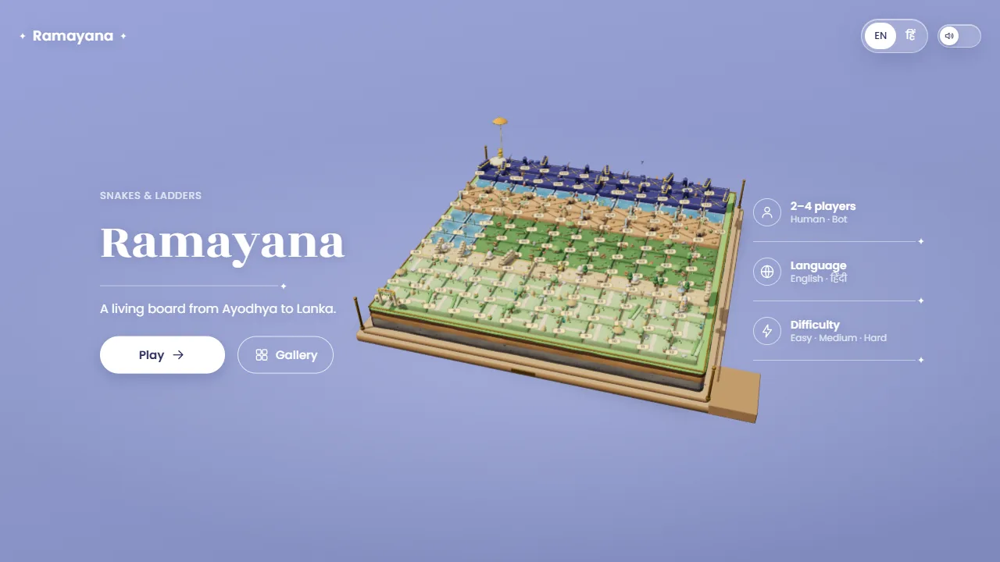

## What is the game?

Ramayana Snakes & Ladders is the classic board game, retold through the Ramayana. Every ladder and every snake on the board is a moment from the epic story, so the board tells the tale as you play.

The board is a small 3D world on a wooden stand, like a model village. You start at the gate of Ayodhya on square 1. You travel through Mithila, the forest and across the sea to Lanka, and you return to Ayodhya's throne at square 144. The first hero to reach the throne wins.

Up to four heroes can play: Rama, Sita, Lakshmana and Hanuman. Each player can be a person or the computer ("Bot"). The heroes speak and react to what happens, so you will hear their comments as the game goes on.

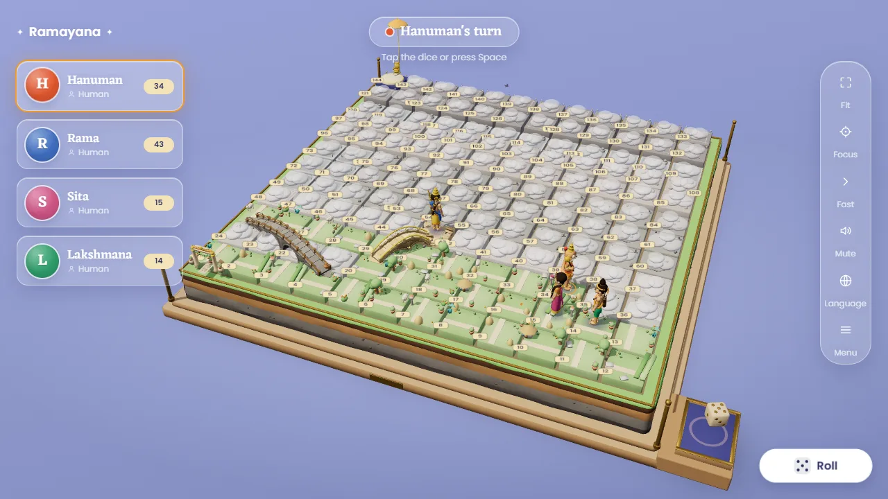

## Starting a game

Tap **Play** on the title screen. The Setup screen opens with one card for each seat.

1. **Choose who sits in each seat.** Tap **Human**, **Bot** or **Empty** on the seat's card. You need at least two seats filled to start. Everyone can play on one device by taking turns.
2. **Choose a hero.** Use the **<** and **>** arrows beside the hero's badge to change the hero. If another seat already has that hero, the two seats swap.
3. **Name the player.** Type a name of up to 12 characters. If you leave it empty, the hero's name is used.
4. **Choose the difficulty** at the bottom left: **Easy**, **Medium** or **Hard**. See the table below for what changes.
5. Tap **Start Game**.

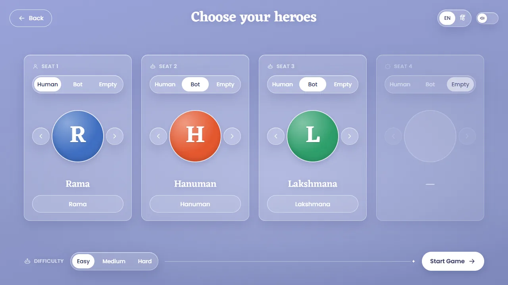

### Board levels

The board is the same map on every level, but the number of ladders and snakes changes. Ladders are easier to find on Easy boards, and snakes build up as the levels get harder.

| Level  | Ladders | Snakes | What is different                                                          |
| ------ | ------- | ------ | -------------------------------------------------------------------------- |
| Easy   | 9       | 6      | The most ladders, and only six snakes.                                     |
| Medium | 7       | 9      | More snakes, including Tataka and Kabandha.                                |
| Hard   | 6       | 13     | Every snake, including Ravana's snake that sends you from 138 down to 78.  |

The full list of ladders and snakes is in [The board's story](#the-boards-story) below.

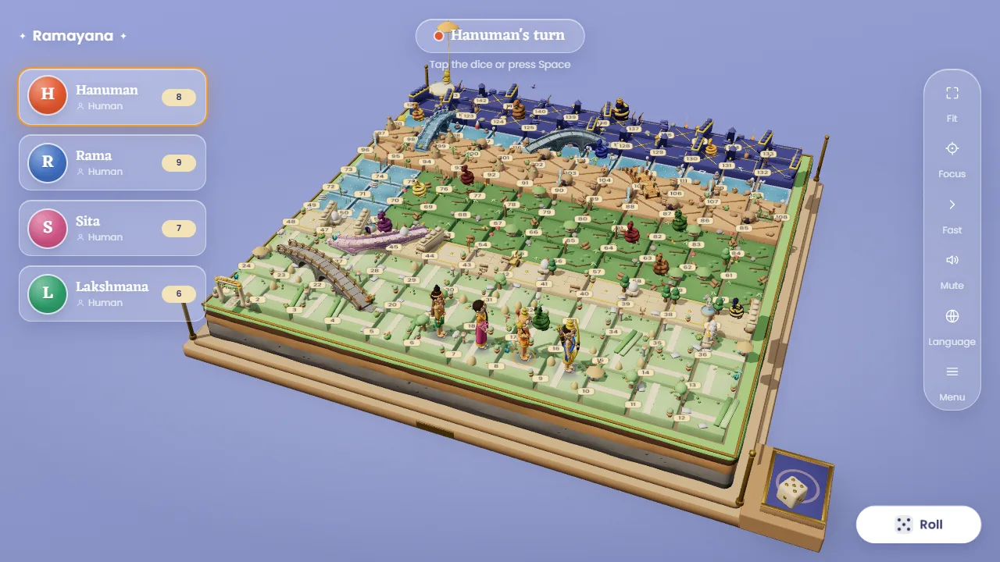

## Playing

1. **Your turn** is shown in the banner at the top, with the hero's name. The seat cards on the left show each player's square. Bots roll for themselves.
2. **Roll the die** by tapping the die in its tray at the corner of the board, by tapping the **Roll** button at the bottom right, or by pressing **Space** (or **Enter**). When it is your turn, the die bobs gently and a ring pulses round it.
3. **Your hero moves** the number of squares shown on the die. Short moves are a walk; longer moves are a run.
4. **A ladder** takes you up to a square higher on the board. In this game the ladders are stone bridges: your hero jumps onto the bridge, runs across it and jumps off at the top. The heroes cheer.
5. **A snake** pulls you back down. The snake rises from its square, swallows your hero, and your hero pops out again at the snake's tail. The heroes sympathise (and Lakshmana grumbles).
6. **Rolling a 6** gives you an extra roll straight away.
7. **Three sixes in a row** void your turn. Your hero goes back to where the turn began.
8. **Overshooting 144** means you bounce back by the number of squares you went past the throne. You must roll the exact number to finish.
9. **The first hero to reach square 144 wins.** The win screen shows the winner and where everyone else got to. **Play Again** starts a new game with the same players, and **Menu** goes back to the title screen.
10. **Play On** continues the game for the other places. It appears when there are still two or more players to rank, so it needs at least three players.

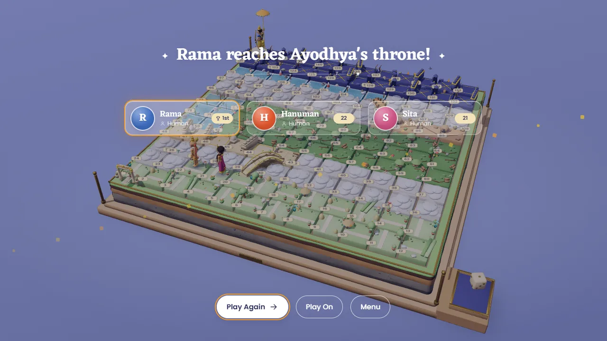

Each hero comments on what happens. The hero whose turn it is usually speaks, and one other hero may join in. Their words appear in speech bubbles above their heads.

### The die

The die lives in a small tray with a blue felt floor on the corner of the stand, next to square 12. It tumbles in the tray each time anyone rolls, so you can watch the bots' rolls too.

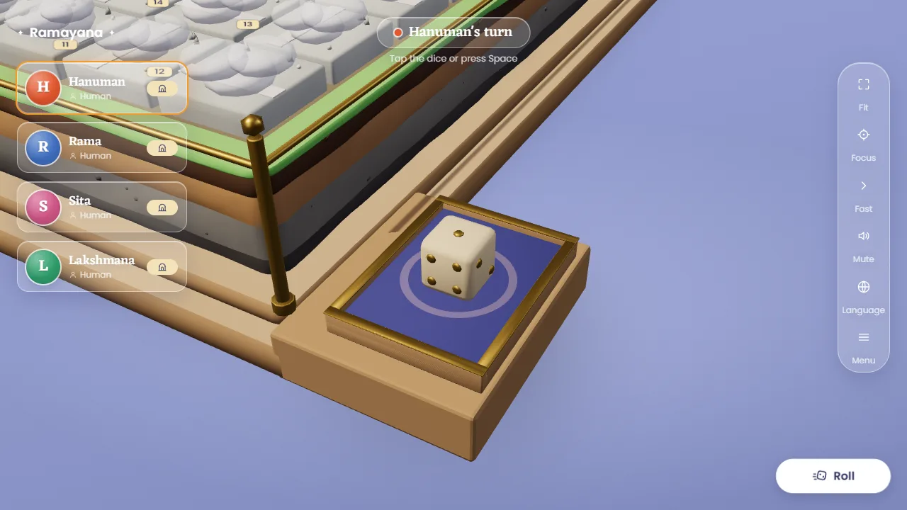

### Fog, and hidden snakes and bridges

At the start of a game the board is covered in cloud. Only the gate (square 1) and the throne (square 144) are clear. Each square clears when a hero walks onto it, so the map opens up as you travel.

The snakes and bridges are hidden too, and the game does not tell you where they are. A bridge rises out of the ground the first time someone lands at its foot. A snake rises the first time someone lands on its head. After that they stay on the board for everyone to see, so you know where to be careful.

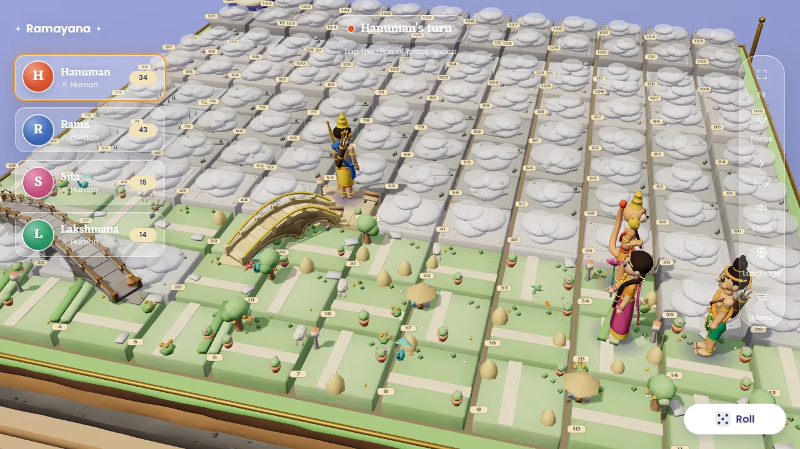

### Snakes and bridges

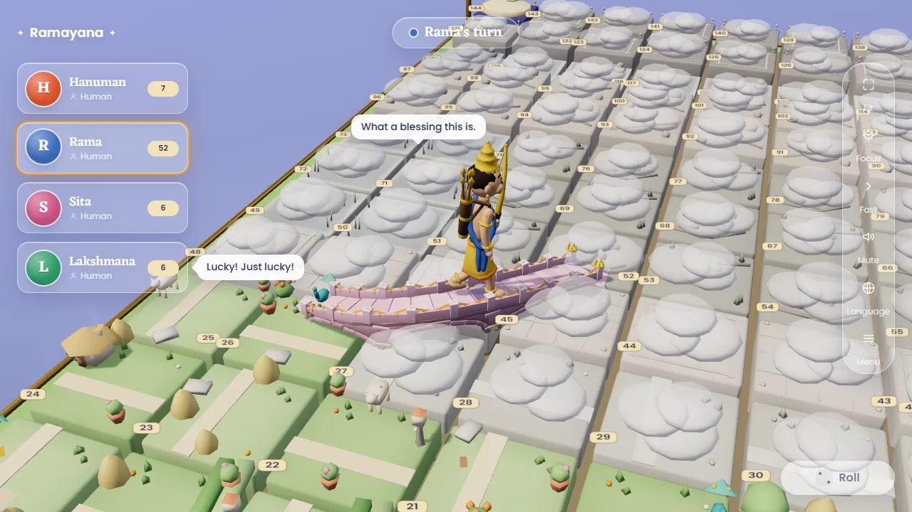

There are nine stone bridges. Each is decorated for its story: for example, the wedding bridge is pink stone hung with saffron garlands and marigolds. When a hero lands at a bridge's foot, the hero leaps on, runs along the deck and leaps off at the top square. Hanuman has a special move: on the bridge of **Hanuman's leap to Lanka** (95 to 122) he does not run, he jumps the whole way in one great leap. The other heroes cross it on foot.

There are thirteen snakes, each coiled on its own square. When a hero lands on a snake's head, the snake rises, wraps round the hero and swallows them. A moment later the hero reappears on the snake's tail square, a little shaken but ready to carry on. The snakes are story villains, but nothing frightening is shown: the hero simply disappears into the coil and comes out again at the tail.

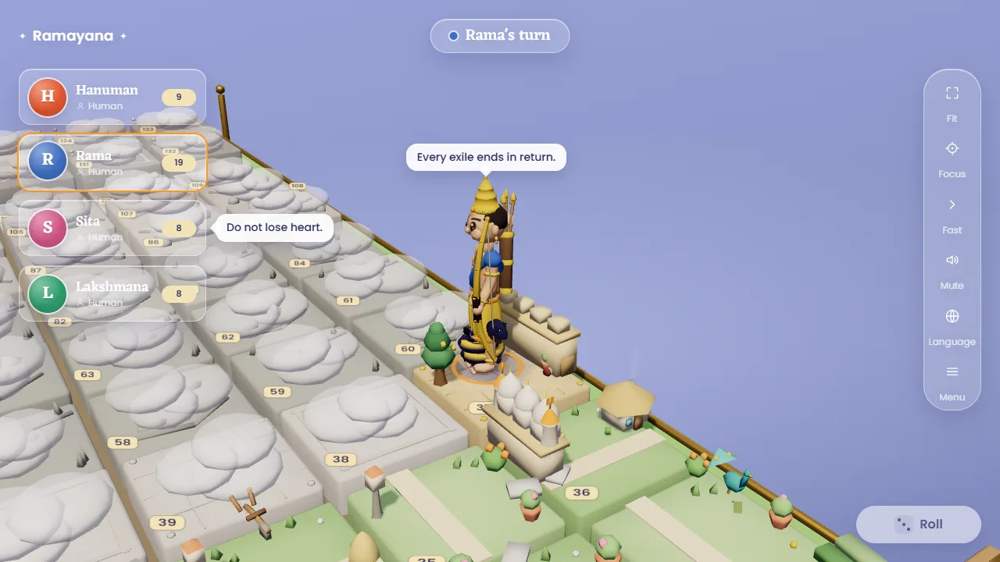

## Looking around the board

You control the camera. It never moves by itself, so if you want to follow a hero, use **Focus**.

| What you want to do  | Mouse                          | Touch                          | Keyboard          |
| -------------------- | ------------------------------ | ------------------------------ | ----------------- |
| Turn the board       | Drag with the left button      | Drag with one finger           | Arrow keys        |
| Zoom in or out       | Scroll the wheel               | Pinch with two fingers         | **+** and **-**   |
| Move across the board | Drag with the right button    | Drag with two or three fingers |                   |
| See the whole board  | Tap **Fit**                    | Tap **Fit**                    | **0** (zero)      |
| Look at the player whose turn it is | Tap **Focus**   | Tap **Focus**                  |                   |

The **Fit** and **Focus** buttons are at the top of the bar on the right, and also in the Menu. Fit frames the whole board again from the side you are looking at, and keeps it clear of the buttons and cards on the screen. The camera cannot go under the board or too far away, so you cannot get lost.

## The heroes

Each hero has a personality and a way of showing feelings. Rama and Sita are calm and dignified, so they never tease or get humiliated. The comedy comes from Hanuman, who is exuberant and playful, and Lakshmana, who is fiery and quick to grumble before he does the right thing.

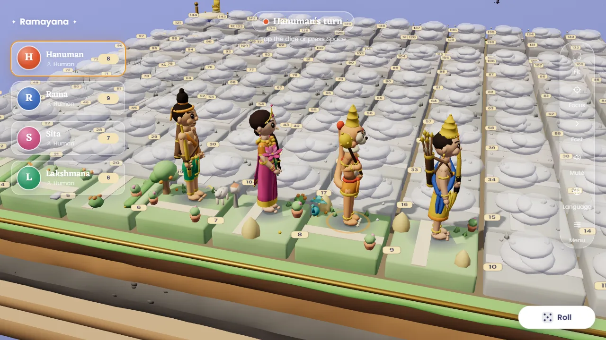

| Hero      | Carries                                   | Personality                                                | How they react                                                                              |
| --------- | ----------------------------------------- | ---------------------------------------------------------- | ------------------------------------------------------------------------------------------- |
| Rama      | His bow and a quiver of arrows            | Composed, warm, patient. Never boastful.                   | Takes a snake with a quiet breath. Congratulates the winner first, even when he loses.      |
| Sita      | A lotus and a garland, with a long braid  | Calm, kind and quietly resilient. Notices how others feel. | Accepts a setback quietly. Warm praise for the winner.                                      |
| Lakshmana | A shorter bow and a quiver of arrows      | Fiery, impatient and fiercely loyal.                       | Cries out at a snake, demands a rematch, then grumbles his way to good sportsmanship.       |
| Hanuman   | His gada (mace), and his long tail        | Exuberant, playful and a little clumsy.                    | Tumbles down a snake, shouts "My tail!", and bounces straight back. Cheerful when he loses. |

The heroes stand on the board, and they walk, run and leap from square to square. They show five feelings (calm, happy, excited, scared and sad) with their faces and their whole bodies, and the winner cheers on the win screen. Rama and Sita show their feelings in a restrained way.

## The board's story

The board has 9 ladders (stone bridges) and 13 snakes. Each one is a moment from the Ramayana, listed here in story order. The last columns show which levels include each jump.

| #   | Kind   | Ramayana event               | Squares    | Easy | Medium | Hard |
| --- | ------ | ---------------------------- | ---------- | ---- | ------ | ---- |
| 1   | Ladder | Vishwamitra's training       | 4 to 25    | Yes  | Yes    | Yes  |
| 2   | Snake  | Tataka the demoness          | 17 to 6    | -    | Yes    | Yes  |
| 3   | Ladder | Breaking Shiva's bow         | 20 to 43   | Yes  | Yes    | -    |
| 4   | Ladder | Wedding of Rama and Sita     | 26 to 52   | Yes  | Yes    | Yes  |
| 5   | Snake  | Manthara's whisper           | 37 to 19   | Yes  | Yes    | Yes  |
| 6   | Snake  | Kaikeyi's two boons          | 46 to 28   | Yes  | Yes    | Yes  |
| 7   | Ladder | Guha's boat across the Ganga | 49 to 74   | Yes  | -      | -    |
| 8   | Snake  | Viradha seizes Sita          | 58 to 40   | -    | -      | Yes  |
| 9   | Snake  | Shurpanakha's revenge        | 64 to 47   | Yes  | Yes    | Yes  |
| 10  | Snake  | The golden deer              | 70 to 56   | Yes  | Yes    | Yes  |
| 11  | Snake  | Sita's abduction             | 76 to 55   | Yes  | Yes    | Yes  |
| 12  | Snake  | Kabandha the headless        | 82 to 68   | -    | Yes    | Yes  |
| 13  | Ladder | Shabari's devotion           | 85 to 108  | Yes  | Yes    | Yes  |
| 14  | Ladder | Meeting Hanuman              | 88 to 113  | Yes  | Yes    | Yes  |
| 15  | Ladder | Alliance with Sugriva        | 92 to 118  | Yes  | -      | -    |
| 16  | Ladder | Hanuman's leap to Lanka      | 95 to 122  | Yes  | Yes    | Yes  |
| 17  | Ladder | Building Rama Setu           | 101 to 127 | Yes  | Yes    | Yes  |
| 18  | Snake  | Indrajit's serpent arrows    | 114 to 96  | Yes  | Yes    | Yes  |
| 19  | Snake  | Prahasta's charge            | 120 to 110 | -    | -      | Yes  |
| 20  | Snake  | Kumbhakarna awakens          | 124 to 106 | -    | Yes    | Yes  |
| 21  | Snake  | Indrajit's Brahmastra        | 130 to 119 | -    | -      | Yes  |
| 22  | Snake  | Ravana's pride               | 138 to 78  | -    | -      | Yes  |

## Controls

You can play with a mouse, a touch screen or the keyboard. The buttons on the right of the game screen are, from top to bottom: **Fit**, **Focus**, **Fast**, **Mute**, **Language** and **Menu**.

| Action                       | Mouse or touch                                 | Keyboard              |
| ---------------------------- | ---------------------------------------------- | --------------------- |
| Roll the die                 | Tap the die in its tray, or tap **Roll**       | Space or Enter        |
| Start a game                 | Tap Start Game (Setup screen)                  |                       |
| Look around the board        | See [Looking around the board](#looking-around-the-board) | Arrow keys, + and -, 0 |
| Turn Fast on or off          | Tap the **Fast** button                        | F                     |
| Mute or unmute the sound     | Tap the **Mute** button                        | M                     |
| Switch English and Hindi     | Tap the **Language** button                    |                       |
| Open or close the Menu       | Tap the **Menu** button                        | Esc                   |

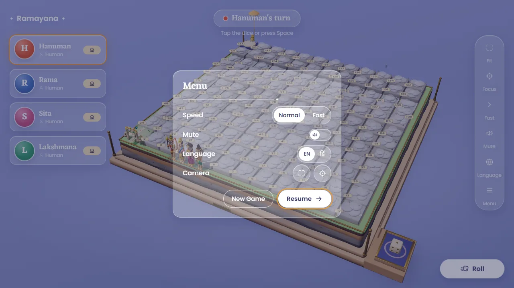

The **Menu** pauses the game. It has the speed (Normal or Fast), Mute, the language, the camera buttons, **New Game** (back to the Setup screen) and **Resume** (back to the board). Opening the Menu or choosing New Game does not delete your game: until it finishes or you start another one, the title screen offers **Resume**.

## Options

- **Fast** makes every move quicker and lets bots roll almost at once. It is handy for games with bots. Press it again to return to normal speed.
- **Mute** turns the sound off. All the sounds, from the die's clatter to the snakes' hiss, are made by the game as it runs, so there are no audio files to download.
- **English / हिंदी** switches the whole game, including the heroes' lines, to Hindi. It is on the title screen, the Setup screen, the game's **Language** button and the Menu. The game remembers your choice next time.
- **Resume** appears on the title screen when you have a game in progress. **New Game** starts again from the Setup screen.
- **Reduced motion:** if your device is set to reduce motion, the game notices it. Heroes glide instead of running, the die shows its number without tumbling, the fog clears at once, snakes and bridges appear without their rising animation, and the small animals, birds and other moving scenery on the board are switched off. A short note, "Reduced motion is on", appears when the game starts.

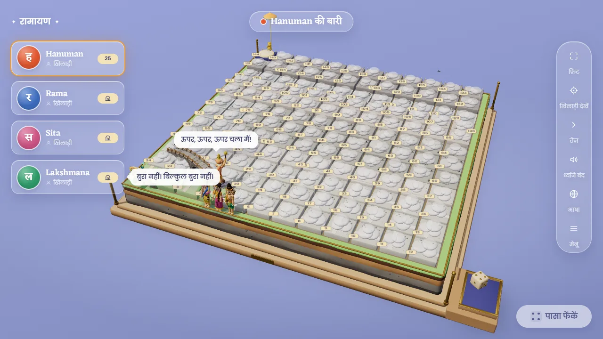

## Saving your game

The game saves after every turn in your browser, including which parts of the board have been uncovered. If you close the window or leave to the title screen, tap **Resume** to carry on where you stopped. When a game finishes, the saved game is cleared. Fast and Mute are not saved; they start off each time you open the game.

## Playing on a phone or tablet

Hold the device in **landscape** (sideways) for the best view. The seat cards become small badges at the top left, and the buttons stay on the right. Use one finger to turn the board and two fingers to zoom and move it.

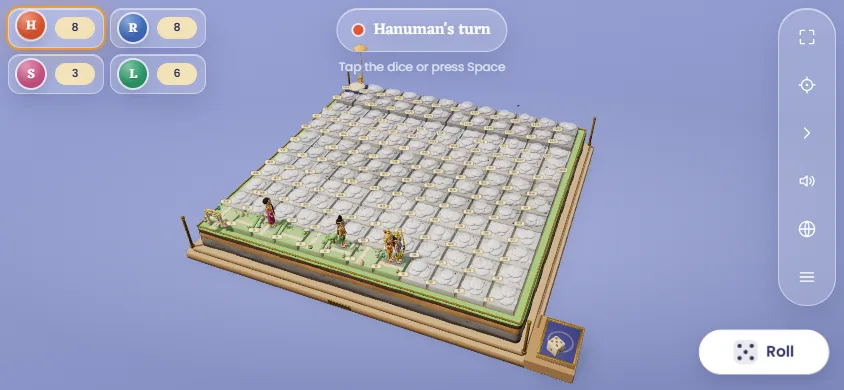

In portrait the game pauses and shows this prompt, and it carries on as soon as you turn the device.

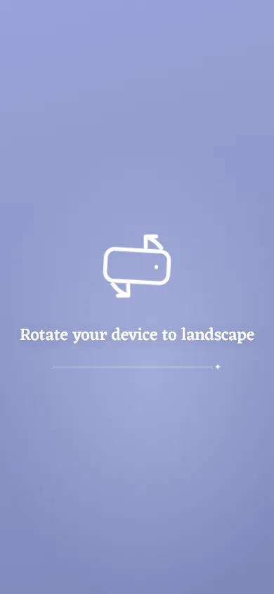

## Questions and answers

**Do I need an account?**
No. There is nothing to sign up for.

**Where is my game saved?**
In the browser on this device, so it is only there on that device and in that browser. Clearing the browser's site data deletes the saved game.

**Does my information leave the device?**
No. The game does not send any game data or personal information anywhere. The fonts, the 3D models and everything else come from the same site as the game, so the page makes no requests to other sites.

**Does it work offline?**
No. The game needs an internet connection to open. Once it has loaded, it runs in the page, but it is not set up to work offline.

**Which devices does it work on?**
It runs in a modern web browser that supports WebGL (3D graphics) on a computer, tablet or phone. It was checked in Microsoft Edge at laptop, tablet and phone sizes. On an older phone the board may move less smoothly.

**Can several people play on one device?**
Yes. Give each seat to a **Human**, and everyone takes turns on the same screen.

**Is it suitable for children?**
The game was written to be family-friendly. The snakes are story setbacks, and the heroes are never shown being humiliated.

**What licence is the game under?**
MIT. See [LICENSE](../LICENSE) for the terms and [CREDITS.md](../CREDITS.md) for the 3D models, fonts and software it uses.
