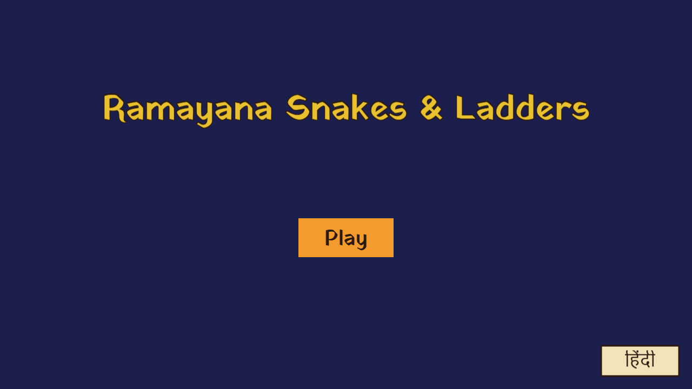
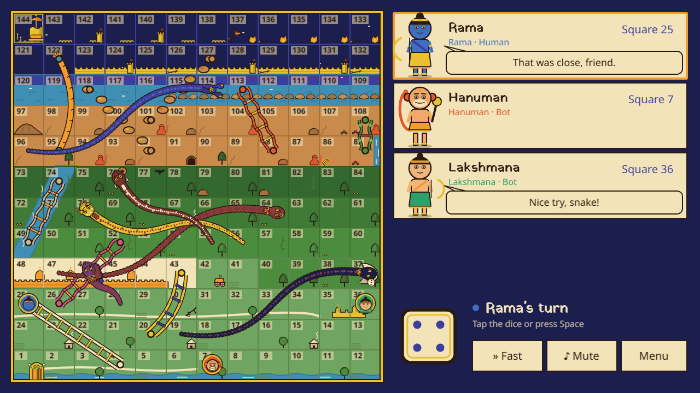
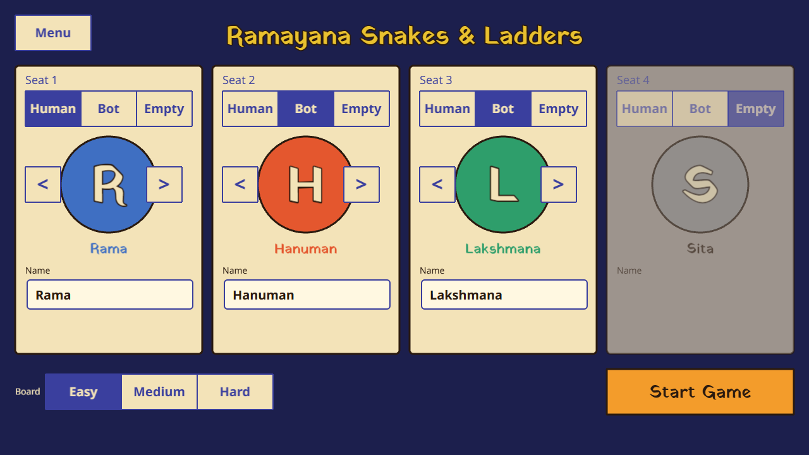
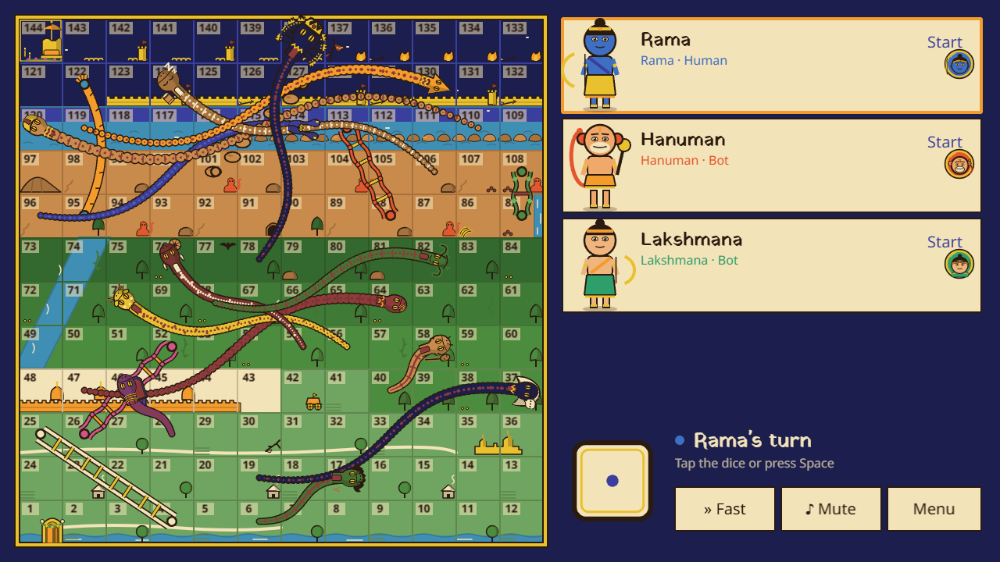
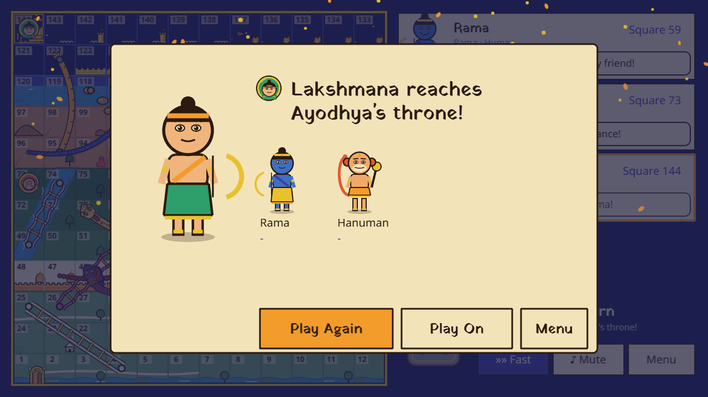
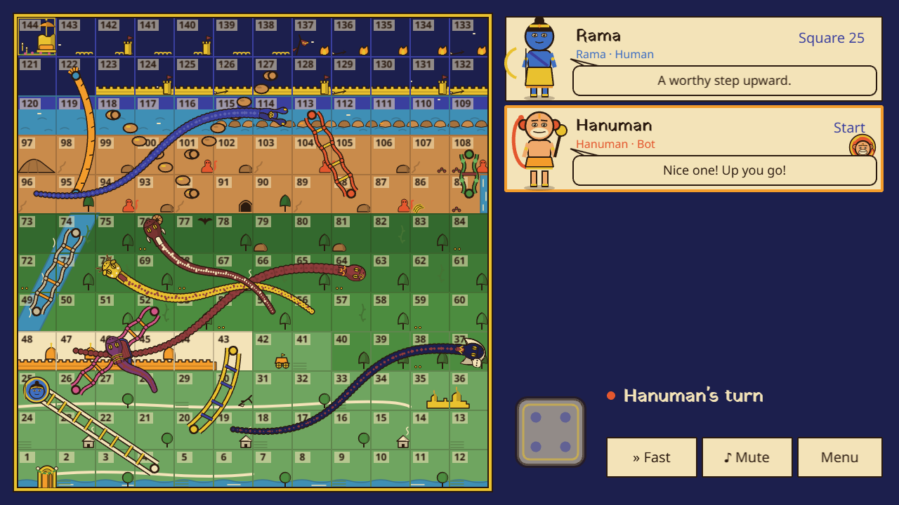
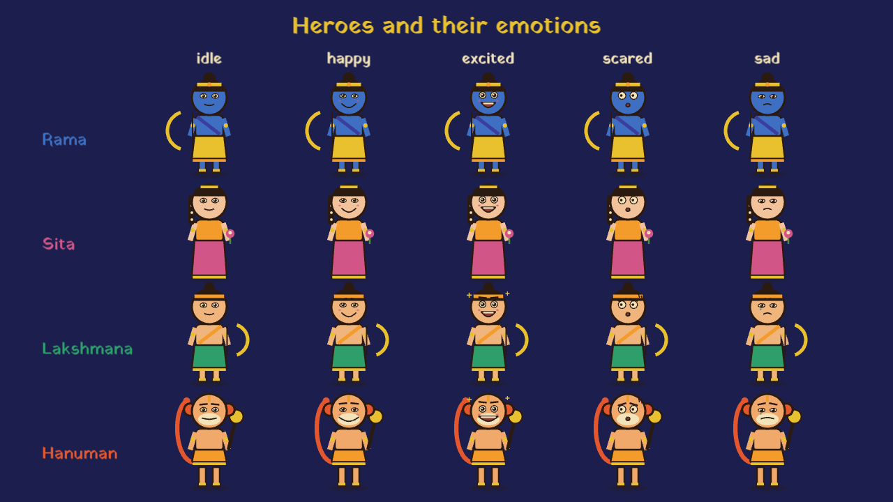
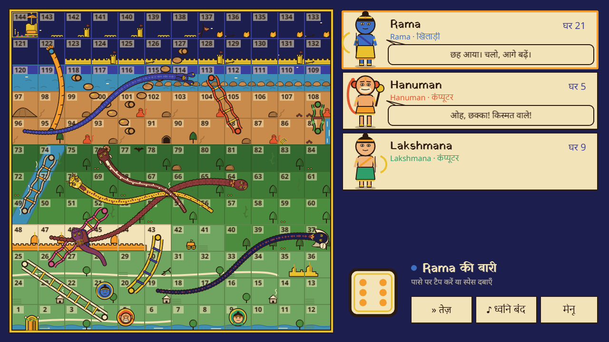

# Ramayana Snakes & Ladders: Player Guide

Welcome! This guide is for families and anyone new to the game. It shows you how to start a game, how to play, and what each part of the board means.

## What is the game?

Ramayana Snakes & Ladders is the classic board game, retold through the Ramayana. Every ladder and every snake on the board is a moment from the epic story, so the board tells the tale as you play.

You start at the gate of Ayodhya on square 1. You travel through the forest and across the sea to Lanka, and you return to Ayodhya's throne at square 144. The first hero to reach the throne wins.

Up to four heroes can play: Rama, Sita, Lakshmana and Hanuman. Each player can be a person or the computer ("Bot"). The heroes speak and react to what happens, so you will hear their comments as the game goes on.

## Starting a game

Tap **Play** on the title screen. The Setup screen opens with one card for each seat.

1. **Choose who sits in each seat.** Tap **Human**, **Bot** or **Empty** on the seat's card. You need at least two seats filled to start. Everyone can play on one device by taking turns.
2. **Choose a hero.** Use the **<** and **>** arrows, or tap the hero's picture, to change the hero.
3. **Name the player.** Type a name of up to 12 characters. If you leave it empty, the hero's name is used.
4. **Choose the board level** at the bottom left: **Easy**, **Medium** or **Hard**. See the table below for what changes.
5. Tap **Start Game**.

### Board levels

The board is the same map on every level, but the number of ladders and snakes changes. Ladders are easier to find on Easy boards, and snakes build up as the levels get harder.

| Level  | Ladders | Snakes | What is different                                                          |
| ------ | ------- | ------ | -------------------------------------------------------------------------- |
| Easy   | 9       | 6      | The most ladders, and only six snakes.                                     |
| Medium | 7       | 9      | More snakes, including Tataka and Kabandha.                                |
| Hard   | 6       | 13     | Every snake, including Ravana's snake that slides you from 138 down to 78. |

The full list of ladders and snakes is in [The board's story](#the-boards-story) below.

## Playing

1. **Your turn** is shown at the top right, with the hero's name. Bots roll for themselves.
2. **Roll the dice** by tapping the dice, or by pressing **Space** (or **Enter**).
3. **Your hero moves** the number of squares shown on the dice, and the board tells the story of where you land.
4. **A ladder** takes you up to a square higher on the board. The heroes cheer.
5. **A snake** pulls you back down. The heroes sympathise (and Lakshmana grumbles).
6. **Rolling a 6** gives you an extra roll straight away.
7. **Three sixes in a row** void your turn. Your hero goes back to where the turn began.
8. **Overshooting 144** means you bounce back by the number of squares you went past the throne. You must roll the exact number to finish.
9. **The first hero to reach square 144 wins.** The win screen shows the winner and the heroes who are still playing.
10. **Play On** continues the game for the other places. It appears when there are still two or more players to rank, so it needs at least three players.

Each hero comments on what happens. The hero whose turn it is always speaks, and one other hero may join in.

## The heroes

Each hero has a personality and a way of showing feelings. Rama and Sita are calm and dignified, so they never tease or get humiliated. The comedy comes from Hanuman, who is exuberant and playful, and Lakshmana, who is fiery and quick to grumble before he does the right thing.

| Hero      | Personality                                                | How they react                                                                              |
| --------- | ---------------------------------------------------------- | ------------------------------------------------------------------------------------------- |
| Rama      | Composed, warm, patient. Never boastful.                   | Takes a snake with a quiet breath. Congratulates the winner first, even when he loses.      |
| Sita      | Calm, kind and quietly resilient. Notices how others feel. | Accepts a setback quietly. Warm praise for the winner.                                      |
| Lakshmana | Fiery, impatient and fiercely loyal.                       | Cries out at a snake, demands a rematch, then grumbles his way to good sportsmanship.       |
| Hanuman   | Exuberant, playful and a little clumsy.                    | Tumbles down a snake, shouts "My tail!", and bounces straight back. Cheerful when he loses. |

The heroes show five feelings: idle, happy, excited, scared and sad. Here they are side by side.

## The board's story

The board has 9 ladders and 13 snakes. Each one is a moment from the Ramayana, listed here in story order. The last columns show which levels include each jump.

| #   | Kind   | Ramayana event               | Squares    | Easy | Medium | Hard |
| --- | ------ | ---------------------------- | ---------- | ---- | ------ | ---- |
| 1   | Ladder | Vishwamitra's training       | 4 to 25    | Yes  | Yes    | Yes  |
| 2   | Snake  | Tataka the demoness          | 17 to 6    | -    | Yes    | Yes  |
| 3   | Ladder | Breaking Shiva's bow         | 20 to 43   | Yes  | Yes    | -    |
| 4   | Ladder | Wedding of Rama and Sita     | 26 to 52   | Yes  | Yes    | Yes  |
| 5   | Snake  | Manthara's whisper           | 37 to 19   | Yes  | Yes    | Yes  |
| 6   | Snake  | Kaikeyi's two boons          | 46 to 28   | Yes  | Yes    | Yes  |
| 7   | Ladder | Guha's boat across the Ganga | 49 to 74   | Yes  | -      | -    |
| 8   | Snake  | Viradha seizes Sita          | 58 to 40   | -    | -      | Yes  |
| 9   | Snake  | Shurpanakha's revenge        | 64 to 47   | Yes  | Yes    | Yes  |
| 10  | Snake  | The golden deer              | 70 to 56   | Yes  | Yes    | Yes  |
| 11  | Snake  | Sita's abduction             | 76 to 55   | Yes  | Yes    | Yes  |
| 12  | Snake  | Kabandha the headless        | 82 to 68   | -    | Yes    | Yes  |
| 13  | Ladder | Shabari's devotion           | 85 to 108  | Yes  | Yes    | Yes  |
| 14  | Ladder | Meeting Hanuman              | 88 to 113  | Yes  | Yes    | Yes  |
| 15  | Ladder | Alliance with Sugriva        | 92 to 118  | Yes  | -      | -    |
| 16  | Ladder | Hanuman's leap to Lanka      | 95 to 122  | Yes  | Yes    | Yes  |
| 17  | Ladder | Building Rama Setu           | 101 to 127 | Yes  | Yes    | Yes  |
| 18  | Snake  | Indrajit's serpent arrows    | 114 to 96  | Yes  | Yes    | Yes  |
| 19  | Snake  | Prahasta's charge            | 120 to 110 | -    | -      | Yes  |
| 20  | Snake  | Kumbhakarna awakens          | 124 to 106 | -    | Yes    | Yes  |
| 21  | Snake  | Indrajit's Brahmastra        | 130 to 119 | -    | -      | Yes  |
| 22  | Snake  | Ravana's pride               | 138 to 78  | -    | -      | Yes  |

## Controls

You can play with a mouse, a touch screen or the keyboard.

| Action                              | Mouse or touch                | Keyboard       |
| ----------------------------------- | ----------------------------- | -------------- |
| Roll the dice                       | Tap the dice                  | Space or Enter |
| Start a game                        | Tap Start Game (Setup screen) |                |
| Turn Fast on or off                 | Tap the **Fast** button       | F              |
| Mute or unmute the sound            | Tap the **Mute** button       | M              |
| Leave the game for the title screen | Tap the **Menu** button       | Esc            |

Leaving with Menu or Esc does not delete your game. You can come back with **Resume**.

## Options

- **Fast** makes moves and bot turns quicker. Press it again to return to normal speed.
- **Mute** turns the sound off. All the sounds are made by the game as it runs, so there are no audio files to download.
- **English / हिंदी** is on the title screen. Tap it to switch the whole game, including the heroes' lines, to Hindi.
- **Resume** appears on the title screen when you have a game in progress. **New Game** starts again from the Setup screen.

## Saving your game

The game saves after every turn in your browser. If you close the window or leave to the title screen, tap **Resume** to carry on where you stopped. When a game finishes, the saved game is cleared.

## Playing on a phone or tablet

Hold the device in **landscape** (sideways) for the best view. In portrait the game pauses and shows this prompt, and it carries on as soon as you turn the device.

## Questions and answers

**Do I need an account?**
No. There is nothing to sign up for.

**Where is my game saved?**
In the browser on this device, so it is only there on that device and in that browser. Clearing the browser's site data deletes the saved game.

**Does my information leave the device?**
The game does not send any game data or personal information anywhere. The only requests to other sites are for the fonts from Google Fonts, which the page loads when it opens.

**Does it work offline?**
No. The game needs an internet connection to open. Once it has loaded, it runs in the page, but it is not set up to work offline.

**Which devices does it work on?**
It runs in a modern web browser on a computer, tablet or phone. It was checked in Microsoft Edge at laptop, tablet and phone sizes.

**Can several people play on one device?**
Yes. Give each seat to a **Human**, and everyone takes turns on the same screen.

**Is it suitable for children?**
The game was written to be family-friendly. The snakes are story setbacks, and the heroes are never shown being humiliated.

**What licence is the game under?**
MIT. See [LICENSE](../LICENSE) for the terms and [CREDITS.md](../CREDITS.md) for the artwork, fonts and software it uses.
