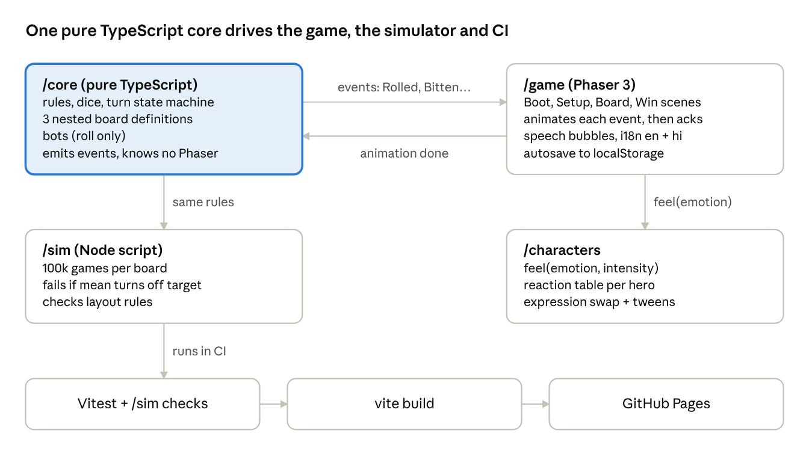

# Ramayana Snakes & Ladders — Design Doc

Oct 25, 2026 · Shiva Kumar Kanuganti

> This is the original design document, written before implementation and copied here from the
> claude.ai working doc. It records the plan; where the shipped game differs (for example, the art
> is hand-authored vector code instead of AI-generated images, and `BIG_JUMP` is 25), the
> [README](../../README.md), [CREDITS](../../CREDITS.md) and [the T30 review](../review/T30-review.md) describe what was built.

## Overview

A 2D, browser-based snakes and ladders game on a 12×12 board, themed on the Ramayana, for 2–4 local players (humans or bots). The four heroes are living characters who react with emotion to every roll, ladder and snake. The game is a nod to Moksha Patam, the Indian original of snakes and ladders.

| #   | Decision            | Choice                                                                                                         |
| --- | ------------------- | -------------------------------------------------------------------------------------------------------------- |
| 1   | Multiplayer         | Local pass-and-play + AI bots; core engine event-driven so online can be added later                           |
| 2   | Platform & engine   | Web first, Phaser 3 + TypeScript                                                                               |
| 3   | Theme               | Ramayana — Ayodhya at square 1, Rama's coronation (Pattabhishekam) at 144                                      |
| 4   | Player characters   | Rama, Sita, Lakshmana, Hanuman; villains live on the board as snakes                                           |
| 5   | Art & animation     | AI-generated art + procedural animation (tweens, expression swaps, particles) behind `character.feel(emotion)` |
| 6   | Emotion scope       | All four characters react to every event, each in character                                                    |
| 7   | Board design        | Hand-designed story boards, tuned by Monte Carlo simulation                                                    |
| 8   | Difficulty          | Easy / Medium / Hard, nested boards, more snakes and fewer ladders per level, a Ravana mega-snake on Hard      |
| 9   | Rules               | Extra roll on 6, triple 6 voids the turn, bounce back past 144, game ends at first winner (optional play-on)   |
| 10  | Audience & language | All ages; English + Hindi via i18n; speech bubbles + sound effects, no voice acting                            |
| 11  | Layout              | Landscape-first; small tokens on the board, large emotive figures in seats; rotate prompt in portrait          |
| 12  | Turn feel           | Tap dice + hero throw pose; step-by-step movement (~120 ms/square, fast mode); bots auto-roll after ~1 s       |
| 13  | Setup & save        | 2–4 seats, hero + human/bot per seat, difficulty picker; autosave to localStorage; no stats or unlocks in v1   |
| 14  | Architecture        | Pure-TS `/core` + `/sim` + Phaser `/game`; Vite, Vitest                                                        |
| 15  | Hosting             | GitHub Pages via GitHub Actions, personal GitHub account                                                       |
| 16  | Art governance      | Style guide, per-hero reference sheet, licence-safe AI tool logged in `CREDITS.md`, respect rules              |

## Game rules

Everyone starts off the board (square 0). The first player to land exactly on 144 wins, and the game ends.

1. The active player taps the dice (a bot rolls automatically after ~1 s). The hero does a throwing pose and the dice lands with a bounce.
2. The token moves the rolled number of squares, one square at a time (~120 ms per square; fast mode jumps).
3. If the move would pass 144, the token reaches 144 and walks back the extra squares (bounce back). Example: on 141, rolling 5 → 144 → back to 142.
4. If the token stops on a ladder foot it climbs; on a snake head it slides down. Only one jump per landing — by design no ladder ends on a snake head, and no snake ends on a ladder foot.
5. A roll of 6 grants another roll. A third consecutive 6 voids the whole turn: the token returns to where it began the turn.
6. Landing on 144 wins. By default the game ends; an optional “play on for places” toggle continues until 2nd, 3rd and 4th are decided.

**Edge cases the core engine must test:**

- Bounce back landing on a snake head → snake applies.
- Bounce back landing on a ladder foot → ladder applies.
- Triple-6 void after a ladder or snake in roll 1 or 2 → restore the position from the start of the turn.
- Two tokens on the same square → allowed, no capture; the tokens fan out visually.
- Bots have no decisions to make; they only roll, so they share the same rules path as humans.

## Characters & emotions

Every event in the core engine triggers `feel(emotion, intensity)` on all seated heroes (2–4), each looked up in their own reaction table. Every hero has five expressions (idle, happy, excited, scared, sad) plus body tweens.

| Hero      | Personality                 | Comic range             | Signature moves                                     |
| --------- | --------------------------- | ----------------------- | --------------------------------------------------- |
| Rama      | Composed, warm, encouraging | None — always dignified | Gentle smile, raised blessing hand, applauds others |
| Sita      | Calm, compassionate         | None — always dignified | Soft concern, serene smile, comforting gesture      |
| Lakshmana | Fiery, loyal, impatient     | Mild (huffs, frowns)    | Arms crossed, stomps, bow-raise on a ladder         |
| Hanuman   | Exuberant, playful, devoted | High — the comic lead   | Somersaults, tail swish, mace twirl, big leaps      |

**Event → reaction table (v1):**

| Event                                     | Active hero                 | Rama                 | Sita        | Lakshmana             | Hanuman              |
| ----------------------------------------- | --------------------------- | -------------------- | ----------- | --------------------- | -------------------- |
| Roll 6 (extra roll)                       | excited                     | nods                 | smiles      | fist pump             | cheers               |
| Ladder climbed                            | happy (big if ≥ 30 squares) | applauds             | happy       | “Well done, brother!” | leaps with joy       |
| Snake bite                                | sad (big if ≥ 30 squares)   | reassures            | concerned   | angry at the snake    | shocked, covers eyes |
| Overtakes another                         | excited                     | calm                 | smiles      | competitive glare     | taunts playfully     |
| Overtaken                                 | scared/sad                  | encourages           | comforts    | huffs                 | pouts                |
| Near miss (stops 1 short of a snake head) | relieved                    | —                    | sighs       | —                     | wipes brow           |
| Waiting near the end (≥ 132)              | scared                      | —                    | —           | taps foot             | fidgets              |
| Triple-6 void                             | sad                         | reassures            | sympathetic | furious               | facepalm             |
| Win                                       | celebrates                  | congratulates        | blesses     | salutes               | somersaults          |
| Lose (game over)                          | —                           | congratulates winner | claps       | grudging bow          | sulks, then claps    |

The “Active hero” column applies to whoever is taking the turn. The per-hero columns apply only when that hero is a bystander. So a bitten Hanuman plays “sad”, and a winning Rama celebrates in his dignified way.

A reaction from the active hero shows a speech bubble (an i18n key, e.g. `hanuman.ladder.big`). Others react silently, except one random bystander per event who also gets a bubble, so the screen does not fill with text.

**Respect rules (binding):**

- Rama and Sita are never humiliated: no pratfalls, crying fits or slapstick. Their “sad” is quiet disappointment.
- Comedy comes from Hanuman and Lakshmana, true to their portrayal in the epic.
- Snakes are Ravana's forces or story setbacks, never a deity.
- On losing, Rama congratulates the winner; he never sulks.

## Board layouts

The three boards are nested and place every snake and ladder in story order: square numbers rise with the Ramayana's chronology, and `/sim` enforces this. Simulated with 100,000 solo games per board, they average **36 / 45 / 64 turns** per player for Easy / Medium / Hard. With 4 players, the winner finishes in about 25 / 31 / 40 turns.

Squares are numbered boustrophedon: row 1 runs 1→12 left to right from the bottom-left corner, row 2 runs 13→24 right to left, and so on up to 144 in the top-left. Story regions by row: rows 1–3 (1–36) Bala Kanda and Mithila; row 4 (37–48) Ayodhya and the exile; rows 5–7 (49–84) the forest, a snake-heavy stretch; rows 8–9 (85–108) Kishkindha, the ladder stretch; rows 10–12 (109–144) Lanka and the war, ending at the coronation on 144.

**Ladders** (a ladder is removed on harder boards, never moved)

| From → To | Climb | Ramayana event                     | Easy  | Medium | Hard  |
| --------- | ----- | ---------------------------------- | ----- | ------ | ----- |
| 4 → 25    | 21    | Vishwamitra's training             | ✓     | ✓      | ✓     |
| 20 → 43   | 23    | Breaking Shiva's bow               | ✓     | ✓      | —     |
| 26 → 52   | 26    | Wedding of Rama and Sita           | ✓     | ✓      | ✓     |
| 49 → 74   | 25    | Guha ferries them across the Ganga | ✓     | —      | —     |
| 85 → 108  | 23    | Shabari's devotion                 | ✓     | ✓      | ✓     |
| 88 → 113  | 25    | Meeting Hanuman                    | ✓     | ✓      | ✓     |
| 92 → 118  | 26    | Alliance with Sugriva              | ✓     | —      | —     |
| 95 → 122  | 27    | Hanuman's leap to Lanka            | ✓     | ✓      | ✓     |
| 101 → 127 | 26    | Building Rama Setu                 | ✓     | ✓      | ✓     |
| **Count** |       |                                    | **9** | **7**  | **6** |

**Snakes** (a snake, once added, stays on every harder board)

| Head → Tail | Fall | Ramayana event                        | Easy  | Medium | Hard   |
| ----------- | ---- | ------------------------------------- | ----- | ------ | ------ |
| 17 → 6      | 11   | Tataka the demoness                   | —     | ✓      | ✓      |
| 37 → 19     | 18   | Manthara's whisper                    | ✓     | ✓      | ✓      |
| 46 → 28     | 18   | Kaikeyi's two boons (exile)           | ✓     | ✓      | ✓      |
| 58 → 40     | 18   | Viradha seizes Sita                   | —     | —      | ✓      |
| 64 → 47     | 17   | Shurpanakha's revenge                 | ✓     | ✓      | ✓      |
| 70 → 56     | 14   | The golden deer (Maricha)             | ✓     | ✓      | ✓      |
| 76 → 55     | 21   | Sita's abduction                      | ✓     | ✓      | ✓      |
| 82 → 68     | 14   | Kabandha the headless                 | —     | ✓      | ✓      |
| 114 → 96    | 18   | Indrajit's serpent arrows (Nagapasha) | ✓     | ✓      | ✓      |
| 120 → 110   | 10   | Prahasta's charge                     | —     | —      | ✓      |
| 124 → 106   | 18   | Kumbhakarna awakens                   | —     | ✓      | ✓      |
| 130 → 119   | 11   | Indrajit's Brahmastra                 | —     | —      | ✓      |
| 138 → 78    | 60   | **Ravana's pride** (mega-snake)       | —     | —      | ✓      |
| **Count**   |      |                                       | **6** | **9**  | **13** |

**Simulation results** (100k games per board, seeded, with the rules in this doc)

| Board  | Mean turns (solo) | Median | 10th–90th percentile | Ladders hit / game | Snake bites / game | 4-player winner turns |
| ------ | ----------------- | ------ | -------------------- | ------------------ | ------------------ | --------------------- |
| Easy   | 35.7              | 34     | 22–51                | 2.1                | 2.0                | 24.9                  |
| Medium | 45.1              | 42     | 28–65                | 1.6                | 3.9                | 31.3                  |
| Hard   | 64.4              | 58     | 34–102               | 2.0                | 8.3                | 39.5                  |

**Layout checks** (enforced by `/sim` in CI): trigger squares (ladder foot, snake head) rise in story order; no two jumps start on the same square; no jump ends on another jump's start; nothing touches 144; at most 2 snake heads in any 6 consecutive squares.

**Targets:** Easy was first aimed at ~30 turns, but that is close to the floor for a 144-square board with bounce-back. CI holds the boards to 36 ± 3, 45 ± 3 and 64 ± 5 turns. Ravana's snake started at 141 → 12, which pushed Hard to 143 turns; at 138 → 78 it still drops a player 60 squares.

**Simulator source** (`sim.mjs`, Node 18+, run with `node sim.mjs`; T11 ports it to TypeScript as `sim/simulate.ts`):

```js
// Monte Carlo simulator for the Ramayana board layouts.
// levels: 'E' = present from Easy up, 'M' = from Medium up, 'H' = Hard only.
// ladders carry `until`: the last level they appear in (removed on harder levels).
const LEVELS = ['E', 'M', 'H'];
const rank = { E: 0, M: 1, H: 2 };

// `seq` = position in the Ramayana; trigger squares (ladder foot / snake head) must ascend with it.
const ladders = [
  { seq: 1, from: 4, to: 25, until: 'H', name: "Vishwamitra's training" },
  { seq: 3, from: 20, to: 43, until: 'M', name: "Breaking Shiva's bow" },
  { seq: 4, from: 26, to: 52, until: 'H', name: 'Wedding of Rama and Sita' },
  { seq: 7, from: 49, to: 74, until: 'E', name: 'Guha ferries them across the Ganga' },
  { seq: 13, from: 85, to: 108, until: 'H', name: "Shabari's devotion" },
  { seq: 14, from: 88, to: 113, until: 'H', name: 'Meeting Hanuman' },
  { seq: 15, from: 92, to: 118, until: 'E', name: 'Alliance with Sugriva' },
  { seq: 16, from: 95, to: 122, until: 'H', name: "Hanuman's leap to Lanka" },
  { seq: 17, from: 101, to: 127, until: 'H', name: 'Building Rama Setu' },
];

const snakes = [
  { seq: 2, from: 17, to: 6, since: 'M', name: 'Tataka the demoness' },
  { seq: 5, from: 37, to: 19, since: 'E', name: "Manthara's whisper" },
  { seq: 6, from: 46, to: 28, since: 'E', name: "Kaikeyi's two boons (exile)" },
  { seq: 8, from: 58, to: 40, since: 'H', name: 'Viradha seizes Sita' },
  { seq: 9, from: 64, to: 47, since: 'E', name: "Shurpanakha's revenge" },
  { seq: 10, from: 70, to: 56, since: 'E', name: 'The golden deer (Maricha)' },
  { seq: 11, from: 76, to: 55, since: 'E', name: "Sita's abduction" },
  { seq: 12, from: 82, to: 68, since: 'M', name: 'Kabandha the headless' },
  { seq: 18, from: 114, to: 96, since: 'E', name: "Indrajit's serpent arrows (Nagapasha)" },
  { seq: 19, from: 120, to: 110, since: 'H', name: "Prahasta's charge" },
  { seq: 20, from: 124, to: 106, since: 'M', name: 'Kumbhakarna awakens' },
  { seq: 21, from: 130, to: 119, since: 'H', name: "Indrajit's Brahmastra" },
  { seq: 22, from: 138, to: 78, since: 'H', name: "Ravana's pride" },
];

{
  const bySeq = [...ladders, ...snakes].sort((a, b) => a.seq - b.seq);
  for (let i = 1; i < bySeq.length; i++)
    if (bySeq[i].from <= bySeq[i - 1].from)
      console.log(
        `STORY ORDER: ${bySeq[i].name} (${bySeq[i].from}) not after ${bySeq[i - 1].name} (${bySeq[i - 1].from})`,
      );
}

function boardFor(level) {
  const L = ladders.filter((l) => rank[level] <= rank[l.until]);
  const S = snakes.filter((s) => rank[s.since] <= rank[level]);
  return { L, S };
}

function validate(level, { L, S }) {
  const errs = [];
  const starts = new Map();
  for (const x of [...L, ...S]) {
    if (starts.has(x.from)) errs.push(`two jumps start at ${x.from}`);
    starts.set(x.from, x);
  }
  for (const x of [...L, ...S]) {
    if (starts.has(x.to)) errs.push(`${x.name} ends on a jump start ${x.to}`);
    if (x.from === 144 || x.to === 144) errs.push(`${x.name} touches 144`);
  }
  // no long snake runs of more than 2 heads in any 6 consecutive squares (unavoidable streak)
  for (let s = 1; s <= 139; s++) {
    const heads = S.filter((x) => x.from >= s && x.from < s + 6).length;
    if (heads >= 3) errs.push(`${heads} snake heads in ${s}..${s + 5}`);
  }
  return errs.map((e) => `[${level}] ${e}`);
}

function playOne({ L, S }, rand) {
  const jump = new Map([...L, ...S].map((x) => [x.from, x.to]));
  let pos = 0,
    turns = 0,
    ladders = 0,
    bites = 0;
  while (pos !== 144 && turns < 2000) {
    turns++;
    const turnStart = pos;
    let sixes = 0;
    for (;;) {
      const r = 1 + Math.floor(rand() * 6);
      if (r === 6 && ++sixes === 3) {
        pos = turnStart;
        break;
      }
      let p = pos + r;
      if (p > 144) p = 288 - p;
      if (jump.has(p)) {
        const t = jump.get(p);
        t > p ? ladders++ : bites++;
        p = t;
      }
      pos = p;
      if (pos === 144 || r !== 6) break;
    }
  }
  return { turns, ladders, bites };
}

// mulberry32, seeded so results are reproducible
function rng(seed) {
  return () => {
    seed |= 0;
    seed = (seed + 0x6d2b79f5) | 0;
    let t = Math.imul(seed ^ (seed >>> 15), 1 | seed);
    t = (t + Math.imul(t ^ (t >>> 7), 61 | t)) ^ t;
    return ((t ^ (t >>> 14)) >>> 0) / 4294967296;
  };
}

const N = 100000;
const allErrs = [];
for (const level of LEVELS) {
  const b = boardFor(level);
  allErrs.push(...validate(level, b));
  const rand = rng(42);
  const turns = [];
  let lad = 0,
    bit = 0;
  for (let i = 0; i < N; i++) {
    const g = playOne(b, rand);
    turns.push(g.turns);
    lad += g.ladders;
    bit += g.bites;
  }
  turns.sort((a, b) => a - b);
  const mean = turns.reduce((a, b) => a + b, 0) / N;
  const pct = (q) => turns[Math.floor(q * (N - 1))];
  // expected 4-player game length: turns of the fastest of 4 players
  const r2 = rng(7);
  const firstOf4 = [];
  for (let i = 0; i < 20000; i++) firstOf4.push(Math.min(...[0, 1, 2, 3].map(() => playOne(b, r2).turns)));
  const m4 = firstOf4.reduce((a, b) => a + b, 0) / firstOf4.length;
  console.log(
    `${level}: ladders=${b.L.length} snakes=${b.S.length} meanTurns=${mean.toFixed(1)} median=${pct(0.5)} p10=${pct(0.1)} p90=${pct(0.9)} ladders/game=${(lad / N).toFixed(1)} bites/game=${(bit / N).toFixed(1)} 4p-winnerTurns=${m4.toFixed(1)}`,
  );
}
console.log(allErrs.length ? allErrs.join('\n') : 'layout constraints OK');
```

## Architecture & tech stack

`/core` is the only place the rules live. The game, the simulator and a future online server all consume its events, so none of them repeats the rules.



The game waits for each event's animation to finish before core starts the next turn. An online mode would replace the local loop with a server that sends the same events.

**Stack:** Vite, TypeScript (strict), Phaser 3, Vitest, ESLint + Prettier. Node is only used for tooling.

**Repo layout** (as planned)

```
src/core/        rules.ts, board.ts, boards/{easy,medium,hard}.ts, turn.ts, bot.ts, events.ts
src/game/        scenes/{Boot,Setup,Board,Win}.ts, ui/, audio.ts, save.ts
src/characters/  Character.ts, reactions/{rama,sita,lakshmana,hanuman}.ts
src/i18n/        en.json, hi.json, i18n.ts
sim/             simulate.ts (fails CI on target drift or layout violation)
public/assets/   art, audio (logged in CREDITS.md)
tests/           core rule tests
.github/workflows/deploy.yml
```

**Core events:** `TurnStarted`, `Rolled`, `Moved`, `Laddered`, `Bitten`, `Bounced`, `NearMiss`, `Overtook`, `TripleSixVoid`, `ExtraRoll`, `Won`, `GameOver`.

**Deployment:** GitHub Actions on a personal account. On push to `main`, the workflow runs lint → Vitest → `/sim` → `vite build` (with `base: '/<repo>/'`) → GitHub Pages. Pull requests run every step except the deploy.

## Art, audio & i18n

All art comes from one style guide and one master reference sheet per hero, so the AI output stays consistent. Every asset is recorded in `CREDITS.md`.

**Style guide:** flat 2D, inspired by Amar Chitra Katha; bold dark outlines, a warm saffron / indigo / gold palette, soft cel shading, and no photorealism.

**Asset list (v1)**

| Asset                                  | Count | Notes                                                                            |
| -------------------------------------- | ----- | -------------------------------------------------------------------------------- |
| Hero body, layered (head, torso, arms) | 4     | Separate layers so procedural tweens can bend arms and bob the head              |
| Hero faces                             | 4 × 5 | idle, happy, excited, scared, sad; swapped on the head layer                     |
| Hero tokens (board)                    | 4     | Small round portrait medallions, readable at ~56 px                              |
| Board background                       | 1     | 12×12 grid over a map from Ayodhya (bottom) to Lanka (top), with a palace at 144 |
| Snakes                                 | 13    | Each styled after its villain; the Ravana snake is ten-headed and largest        |
| Ladders                                | 9     | Thematic: vines, bow, boat, Setu stones, Hanuman's tail                          |
| Dice                                   | 1     | Carved wood with gold pips                                                       |
| UI frame, seats, speech bubble         | 1 set | Palm-leaf manuscript texture                                                     |

**Pipeline:**

1. Generate the style guide and hero reference sheets first, and approve them before any other asset.
2. Generate poses and faces from the reference sheet (image-to-image or character reference).
3. Clean up and cut into layers (remove background, split limbs), then export WebP spritesheets with TexturePacker or free-tex-packer.
4. Log the tool, plan, date and prompt for each asset in `CREDITS.md`. Confirm that the tool's current terms allow public or commercial use.
5. **Fallback:** if consistency fails, switch to hand-made vector cutouts (Inkscape or Figma).

**Audio:** a tanpura + bansuri background loop; a bansuri phrase on a ladder; a low mridangam hit on a snake bite; a dice clatter; a temple bell on a win. Use royalty-free or CC0 sources only, logged in `CREDITS.md`. Add mute and volume controls.

**i18n:** every string is a key in `en.json` / `hi.json`, with no hard-coded text. Use a Devanagari web font (e.g. Noto Sans Devanagari). The speech bubble lines are written per hero and per event, with 2–3 variants each to avoid repetition.

## Milestones & tasks by model

The split: **Fable 5.1** handles design and creative work, **Opus 5.5** handles complex logic and architecture, and **Sonnet 5.5 / Haiku 5.5** handle well-specified tasks. Sonnet takes tasks that touch several files; Haiku takes single-file boilerplate. Image generation is a **Human** task done in the chosen AI art tool.

| ID  | Milestone   | Task                                                                                | Model      | Depends on |
| --- | ----------- | ----------------------------------------------------------------------------------- | ---------- | ---------- |
| T01 | M0 Design   | Hero personality bible + English speech lines (2–3 variants per hero per event)     | Fable 5.1  | —          |
| T02 | M0 Design   | Art style guide + AI prompt pack for the 4 hero reference sheets                    | Fable 5.1  | —          |
| T03 | M0 Design   | Board art direction: story region per row, concept per snake and ladder             | Fable 5.1  | —          |
| T04 | M0 Design   | UX flow + landscape wireframes: Setup, Board, Win, rotate prompt                    | Fable 5.1  | —          |
| T05 | M0 Design   | Emotion timing spec: duration, intensity and tween per reaction                     | Fable 5.1  | T01        |
| T06 | M1 Core     | Scaffold repo: Vite + TS strict + Phaser 3 + Vitest + ESLint, README, LICENSE       | Haiku 5.5  | —          |
| T07 | M1 Core     | Seeded RNG + injectable dice                                                        | Haiku 5.5  | T06        |
| T08 | M1 Core     | Turn state machine + rules + event emitter (extra roll, triple-6 void, bounce-back) | Opus 5.5   | T07        |
| T09 | M1 Core     | Rule tests for every edge case in Game rules                                        | Opus 5.5   | T08        |
| T10 | M1 Core     | Board data for Easy / Medium / Hard + layout validator                              | Sonnet 5.5 | T06        |
| T11 | M1 Core     | Port `/sim` to TS with CI thresholds (36±3, 45±3, 64±5 turns)                       | Sonnet 5.5 | T08, T10   |
| T12 | M1 Core     | GitHub Actions: lint → test → sim → build → Pages deploy                            | Sonnet 5.5 | T06        |
| T13 | M2 Playable | Board scene: boustrophedon grid, step movement, event queue with ack, token fan-out | Opus 5.5   | T08        |
| T14 | M2 Playable | Setup scene: seats, hero, human/bot, difficulty, names                              | Sonnet 5.5 | T04, T13   |
| T15 | M2 Playable | Dice UI, bot auto-roll, 1×/2× speed, fast mode                                      | Sonnet 5.5 | T13        |
| T16 | M2 Playable | Autosave and resume via localStorage (try/catch guarded)                            | Haiku 5.5  | T08        |
| T17 | M2 Playable | Rotate-device overlay + placeholder Win scene                                       | Haiku 5.5  | T13        |
| T18 | M3 Alive    | Character system: `feel()`, face swap, tween library, 4 simultaneous reactions      | Opus 5.5   | T05, T13   |
| T19 | M3 Alive    | Derived events: NearMiss, Overtook, waiting-near-end                                | Sonnet 5.5 | T08        |
| T20 | M3 Alive    | Reaction tables for 4 heroes + speech bubble with bystander pick                    | Sonnet 5.5 | T18, T01   |
| T21 | M3 Alive    | i18n loader + `en.json` from T01 lines, Devanagari font                             | Haiku 5.5  | T01        |
| T22 | M3 Alive    | Hindi translation of all lines with matching tone per hero                          | Fable 5.1  | T21        |
| T23 | M4 Art      | Generate and approve all art in the AI tool, using the T02 prompt pack              | Human      | T02, T03   |
| T24 | M4 Art      | Asset pipeline: layer cutting, spritesheet packing, loader manifest                 | Sonnet 5.5 | T23        |
| T25 | M4 Art      | Integrate art: board, snakes and ladders placed from board data, heroes             | Sonnet 5.5 | T24, T18   |
| T26 | M4 Art      | `CREDITS.md` with tool, date and licence per asset                                  | Haiku 5.5  | T23        |
| T27 | M5 Polish   | Audio manager + mute and volume, wire sounds to events                              | Haiku 5.5  | T13        |
| T28 | M5 Polish   | Particles and juice: ladder sparkle, snake dust, win confetti                       | Sonnet 5.5 | T25        |
| T29 | M5 Polish   | Performance + tablet browser test pass, bug triage                                  | Opus 5.5   | T25        |
| T30 | M5 Polish   | Final review against respect rules + playtest notes                                 | Fable 5.1  | T29        |
| T31 | M5 Polish   | README with play link and screenshots; tag v1.0                                     | Haiku 5.5  | T30        |

**Totals:** 31 tasks: Fable 7, Opus 5, Sonnet 10, Haiku 8, Human 1. Do M0 and M1 in parallel; M2 needs T08; M3 is the gate where we check the characters feel alive with placeholder faces before any art is generated.

## Out of scope & risks

**Not in v1:** online multiplayer, accumulating moods, a larger character roster, statistics and unlocks, voice acting, languages beyond English and Hindi, a store app, and an itch.io release.

| Risk                                                                     | Mitigation                                                                                            |
| ------------------------------------------------------------------------ | ----------------------------------------------------------------------------------------------------- |
| AI art is inconsistent across poses and faces                            | Reference sheet first, faces as swappable layers; fall back to vector cutouts (Inkscape or Figma)     |
| Licence terms of the AI tool change or forbid public use                 | Check terms before T23; log every asset in `CREDITS.md`; regenerate if needed                         |
| Depictions of Rama and Sita cause offence                                | Binding respect rules; T30 review; invite 2–3 playtesters from the target audience                    |
| Hard mode feels punishing (p90 = 102 turns)                              | Sim thresholds in CI; consider a “kind Hard” mode later if playtests complain                         |
| Four characters reacting at once is visually noisy                       | At most one bystander speech bubble per event; reactions staggered by 80–150 ms                       |
| 12×12 cells too small on small tablets                                   | Landscape-first, minimum cell size checked in T29; tokens readable at 56 px                           |
| Phaser and the animation layer drift apart when upgrading to Spine later | All animation goes through `feel()`; game code never calls tweens on heroes directly                  |
| Work account and IP                                                      | Personal GitHub account and personal time; check the employer's side-project policy before publishing |
