# T44.14 — Integration 2: all heroes, snakes and bridges, performance and cleanup

**What to look at:** the integrated diorama with the four rigged heroes, the 13 coiled snakes and the 9 stone bridges,
after the T44.14 fixes: Kaikeyi's full strike behind the lowered wedding bridge, Fit clear of the HUD, one dice tray,
the faster Fast mode, the snake and bridge sounds, and the budgets.

Branch `feat/diorama-3d`. Every capture is from the running app in headless Edge, driven only through `window.__app`
and queued dice (`scripts/review/capture.mjs`); nothing is staged by poking the view. Regenerate with:

```
npm run build && npx vite preview --port 4194        # or any running dev server
node scripts/review/capture.mjs screenshots-tmp/review http://localhost:4194
node scripts/review/webp.mjs screenshots-tmp/review docs/review/images/t44-integrated fit-desktop,fit-phone,...
node scripts/review/perf.mjs http://localhost:4194 hard
node scripts/review/games.mjs http://localhost:4194 easy:normal,hard:normal,easy:fast,hard:fast,easy:fast:rm
```

## What changed in T44.14

| Area | Change |
|---|---|
| Kaikeyi and the wedding bridge (owner) | Kaikeyi is back to the standard pose: R 2.8 (T42 table), raised head over the coil, full strike (mouth travel 0.18 u, was 0.054 u). The straight wedding route passed 0.2 u in front of her coil centre, so its ribbon covered the whole coil and the rising neck: **no deck height** gave a slot for a full strike (measured on every vertex of every clip). The deck therefore also **bows 0.6 u toward the viewer** over 45–46, and its hump is **lowered and flattened from 0.39 to 0.20 u**. Every vertex of every Kaikeyi clip stays more than 0.05 u clear of the deck body (test `Kaikeyi_(FullStrikeOn46)…`). Crossed squares are now 27, 45, 46 (was 45, 46, 47). |
| Held poses on export | Hanuman and Lakshmana exported without static channels, so held poses snapped to rest (Lakshmana's idle bow: 17.8° tilt in the game vs 9.85° built). All four heroes now keep static channels, and a new `prune-anim.mjs` drops only the channels that sit at the rest pose. Heroes went from 343 KB to 171–190 KB each; snakes from about 105 KB to 55–66 KB (skinned-vertex drift under 0.001 u). |
| Fit and the HUD | Fit reads the HUD boxes (seat cards, banner, toolbar, Roll pill, marked `data-fit-reserve`) and keeps every edge square, the gate, the four waiting heroes and the die tray out from under them. It replaces T44.8's fixed 52 px slide. |
| Dice tray | One tray: the ledge's tan well is gone, and die.glb's teak tray stands on the oak, so its indigo felt shows. |
| Fast | Every beat scales: bot delay 400 → 60 ms, die 0.4 → 0.14 s and the move sets off while it lands, run 560 → 1680 u/s, bite ≈ 0.5 → 0.25 s, deck run 10 → 20 u/s, step leaps halved, fog lift 120 → 60 ms. Normal speed is unchanged. |
| Audio | The view cues `stone` as a bridge rises, and `hiss` (first rise), `strike`, `gulp` and `pop` on a snake's beats. The controller plays them through the existing `Audio` (Fast and Mute honoured; a muted `Audio` makes no node, test with a counting AudioContext). |
| Polish | Snake eyes have a visible catch-light (it was buried inside the eye). A risen bridge puffs dust at its abutments and piers. `__app.metrics()` adds `textureMb` and `bytesLoaded`. |
| Budgets in smoke | `npm run smoke` stands every snake and bridge (`__app.revealAll(true)`) and fails above the desktop budgets. |
| Cleanup | Deleted the 2D iso pipeline: `scripts/art/` (iso, anatomy, tokens, gen/check), `public/assets/iso` (5.5 MB), `public/assets/tokens`, `art-src/iso`, their 8 test files and 13 `art:*` scripts; the T44.2 spike (`spike.html`, `src/spike/main.ts`, `public/models/spike`, `hanuman_spike.py`, `spike-check.mjs`, 2 scripts); the unused `snakeCurve`. Phaser was already gone. Kept, because the 3D code still imports them: `src/game/iso/{boardIso,isoKit,camera.json,world,tokenPose,locomotion}`, `src/game/board/blockRules.ts`, `reveal.ts`, i18n, audio. Kept dev preview pages that drive the Blender checks: `hero.html`, `snake.html`, `dice.html`. |
| Review scripts | `scripts/review/` (capture, perf, games, webp, lib) replace the uncommitted `screenshots-tmp/t448/` scripts and use only `window.__app` plus the queued-dice seam. |

## Captures

### Fit — desktop 1280x720 and phone 844x390, four seats

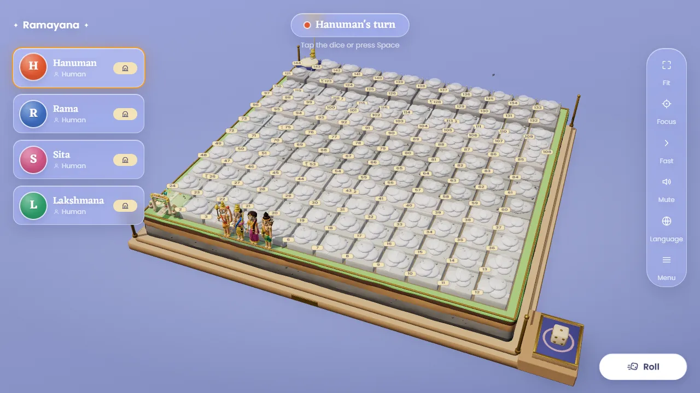

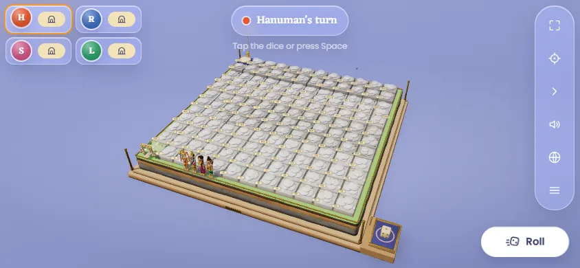

### Each hero on the board

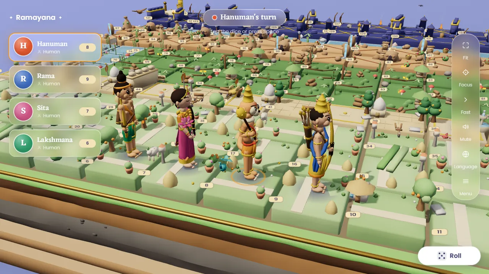

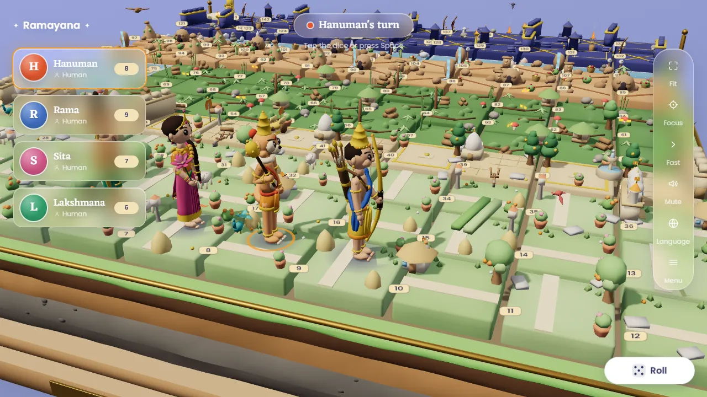

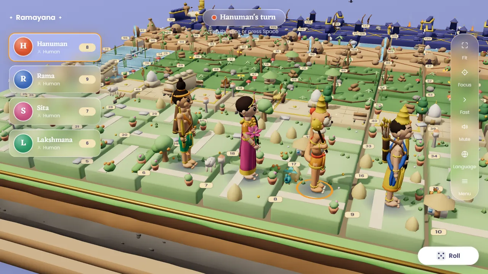

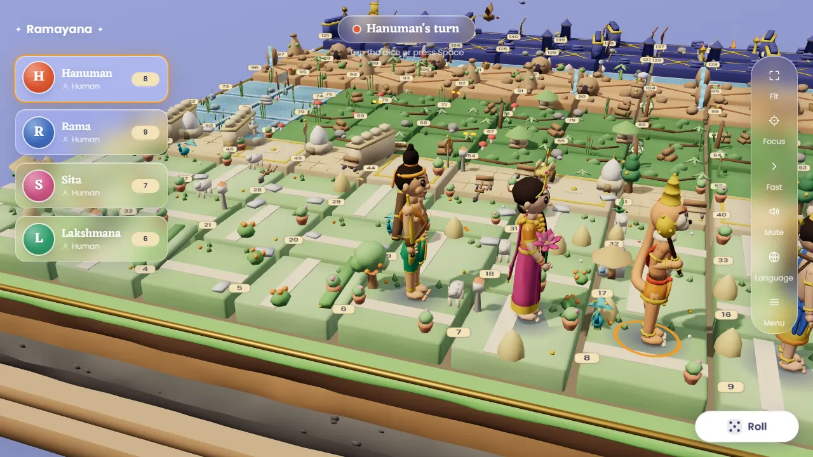

### Snake bites (six evenly spaced frames of the turn)

Rama on Manthara (37 → 19):

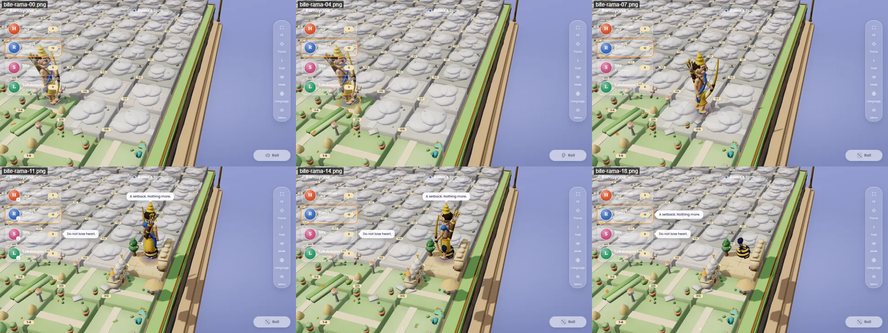

Sita on Shurpanakha (64 → 47):

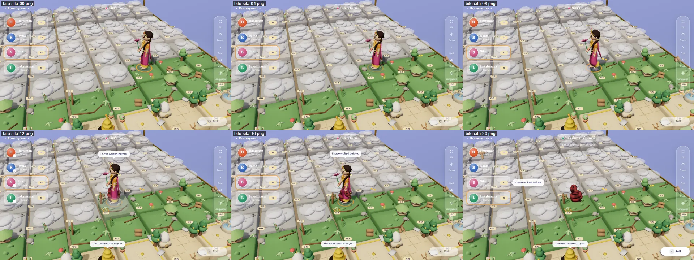

### Kaikeyi strikes under the wedding bridge (Hanuman, 46 → 28)

The deck runs in front of the token and fades while a hero stands behind it; Kaikeyi's head comes forward over the
coil to the token.

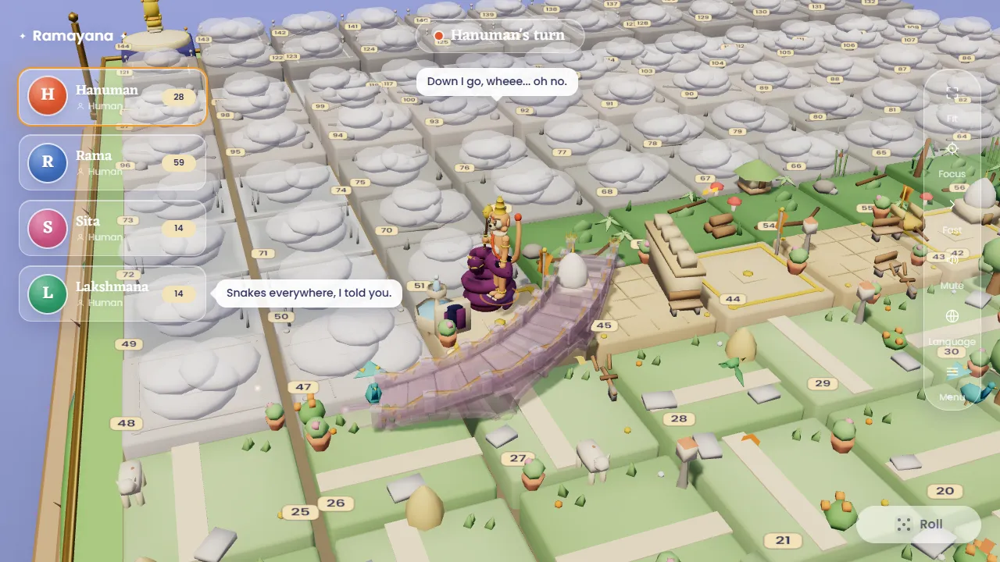

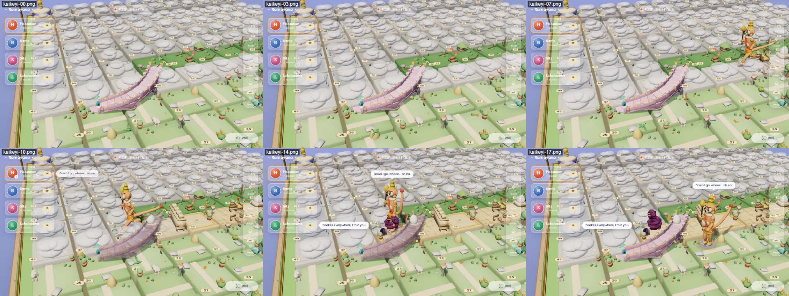

### Bridge crossing (Rama on the wedding bridge, 26 → 52)

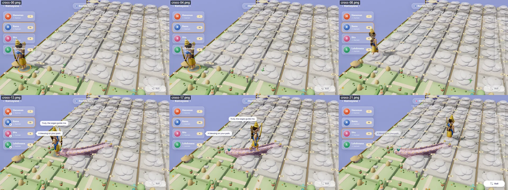

### The dice tray

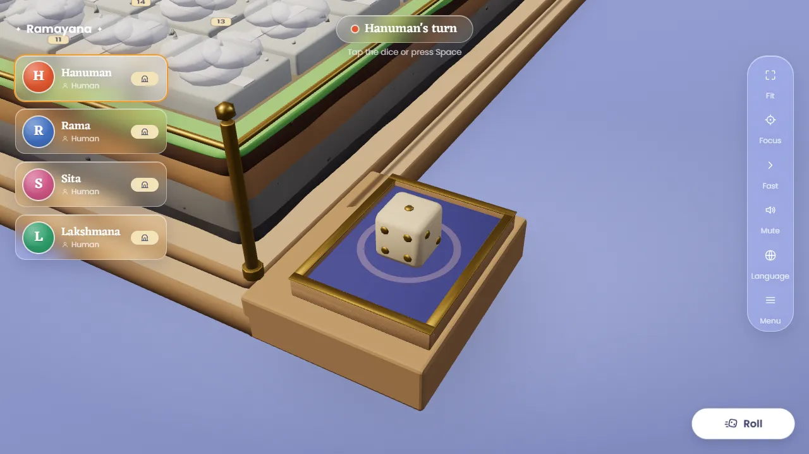

### Win (Easy, 4 bots, Fast)

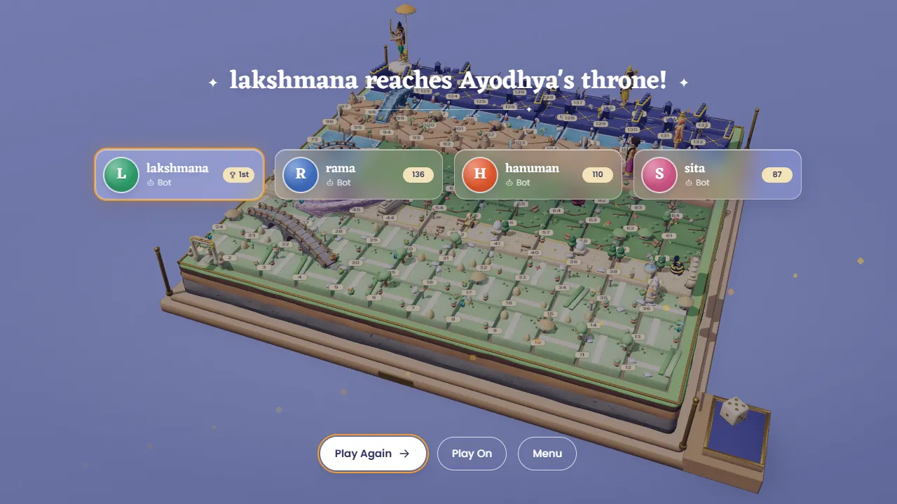

## Metrics

Production build (`vite preview`), headless Edge, `scripts/review/perf.mjs`: a Hard 4-bot game in Fast to the Win
screen with the renderer sampled every second, then every block, all 13 snakes and all 6 Hard bridges standing
(`revealAll(true)`) at Fit. Draw calls are one frame; "shadow" counts visible shadow casters (one directional light).
Before = `ac8357f` (start of T44.14); its build has no `revealAll(true)`, so its "standing" row only has the jumps
the game had revealed, and no `textureMb`.

| Metric | Before, desktop | After, desktop | Before, phone | After, phone | Budget phone / desktop |
|---|---|---|---|---|---|
| Draw calls, main (max during play) | 89 | 83 | 88 | 87 | ≤ 150 / ≤ 180 |
| Draw calls, main (all jumps standing) | 86 (partial) | 87 | 86 (partial) | 93 | ≤ 150 / ≤ 180 |
| Shadow pass (max) | 43 | 45 | 39 | 39 | ≤ 50 / ≤ 60 |
| Triangles (max) | 180 k | 184 k | 172 k | 184 k | ≤ 350 k / ≤ 500 k |
| Frame rate, headless (min / avg) | 49.9 / 60 | 49.2 / 59.7 | 58 / 60 | 59.9 / 60 | ≥ 24 headless |
| GPU textures, estimate with mipmaps | — (env map alone 6.3 MB) | 11.6 MB | — | 11.6 MB | ≤ 8 MB |

GPU texture estimate after: chip atlas 1024² 5.6 MB, four face atlases 4.2 MB, contact-shadow target 1.0 MB,
environment 0.7 MB (was a 768 x 1024 half-float map, 6.3 MB, before the 64 px cube), small sprites. The spec's own
list (atlas 1024² + four 1024 x 192 faces) is 9.5 MB with mipmaps, so the 8 MB line needs either a smaller chip atlas
or smaller faces; not done here.

Downloads (JS and CSS brotli as a host serves them; GLBs and fonts at file size):

| Asset | Before | After | Budget |
|---|---|---|---|
| JS | 364 KB | 313 KB | ≤ 380 KB |
| Fonts | 359 KB | 359 KB | ≤ 420 KB |
| Board, props, landmarks, die | 471 KB fetched | 467 KB | ≤ 300 + 450 + 400 KB |
| Heroes (4) | 1,020 KB | 714 KB (171–190 each) | ≤ 380 KB each |
| Snakes (13, lazy + idle preload) | 1,389 KB | 786 KB (55–66 each) | ≤ 70 KB each (ravana ≤ 110) |
| Bridges (9, lazy + idle preload) | 186 KB | 186 KB | ≤ 60 KB each |
| **First interactive** (JS, CSS, fonts, board set, 4 heroes, page) | ≈ 2.23 MB | **≈ 1.87 MB** (≈ 1.52 MB with 2 heroes) | ≤ 2.6 MB |
| **Total, 4 heroes, every jump** | ≈ 3.8 MB | **≈ 2.85 MB** | ≤ 6.0 MB |
| Dead files in `dist/` (iso atlases, spike) | 5.5 MB | 0 | — |

The first-interactive figures above are sums by kind (everything the board needs before the first roll). Measured in
the browser, `bytesLoaded` 2.5 s after the board appears is **2.87 MB**: it also holds the snake and bridge sets
(0.79 + 0.13 MB), which a snake or bridge does not wait for, but which `Snakes`/`Bridges` preload in idle time
(`requestIdleCallback`) and headless Edge runs that within a second of the board appearing. So the board is
interactive on about 1.9 MB, and by the time the idle preload has finished the page has fetched 2.87 MB, over the
2.6 MB line if that line is meant to include the idle preload. Deferring the preload until after the first turn would
keep the measured number under it; not done.

## Full games

Production build (`vite preview`), 4 bots (Hanuman, Rama, Sita, Lakshmana; these runs and the Win capture used
lower-case bot names, since fixed in the scripts), `scripts/review/games.mjs`; time from
the board appearing to the Win dialog. Zero console errors and zero page errors in every game.

| Game | Speed | Winner | Time |
|---|---|---|---|
| Easy, 4 bots | Normal | Rama | 317 s |
| Hard, 4 bots | Normal | Rama | 974 s |
| Easy, 4 bots | Fast | Lakshmana | 29 s |
| Hard, 4 bots | Fast | Hanuman | 61 s |
| Easy, 4 bots, `prefers-reduced-motion: reduce` | Fast | Sita | 98 s |

Other Hard 4-bot Fast games to Win in this task: 35 s and 41 s (perf runs, desktop and phone, production build) and
61 s on the dev server with 211 rolls. Before T44.14 the same game took 147 s (T44.8) and 215–340 s on `ac8357f` (those two ran while a capture run
competed for the CPU, so they are upper bounds).
The time follows the number of rolls (about 0.29 s per roll in Fast, 150–210 rolls for a Hard game), so a long game
can still go just over a minute. Under reduced motion moves glide at run speed instead of Fast's sprint.

`npm run devices`: all five profiles OK (laptop 49 fps, iPads 58, phone landscape 58 fps headless; portrait shows the
rotate prompt). `npm run verify`: lint, 688 tests, sim, build and smoke (with the budget check) green.

## Not done / open

| # | Item | Note |
|---|---|---|
| 1 | GPU textures over 8 MB (11.6 MB estimated) | See Metrics. |
| 2 | Real-phone frame rate | Headless only. |
| 3 | `PerformanceMonitor` DPR policy (spec 10: 1.5 → 1.25 under load) | Not built; headless phone profile holds 60 fps. |
| 4 | Sita's garland idle sway | The garland is weighted rigidly to the chest; a sway needs a new bone and clip keys in `sita.py`. |
| 5 | Wedding bridge plan change (look) | The owner asked to lower the hump; lowering alone cannot clear a full strike (see above), so the deck also bows 0.6 u toward the viewer. It now hangs over the front edge of 45–46 and clips 27's back corner, and the white dome on 45 stands right against its back parapet (captured with every jump standing from two angles; no prop pokes through the deck itself). The hump is 0.20 u along the whole span, not only over 46. Owner to confirm the look. |
| 6 | A long Hard Fast game can take just over 60 s | 61 s in one run of four; see Full games. |
| 7 | Fast numbers diverge from spec 4/5.4/7 Fast columns | Spec 5.4 annotated; locomotion, die and crossing Fast values changed with their tests. |
| 8 | Download line with the idle preload | 2.87 MB measured vs 2.6 MB; see Metrics. |
| 9 | T44.8 scenes not ported | Boot, Setup, region close-ups, fog mid-reveal, bubble, die rolling and chhatra are not in `scripts/review/capture.mjs` (only the scenes of this pack). |
| 10 | Pier dust | Built and type-checked; not caught in a capture. |
| 11 | Hero shots | Medium shots: the camera's minimum distance is 6 u. |
