# T44.8 — Look checkpoint: the integrated diorama

**What to decide:** whether the board, Hanuman, the props, the light and the UI now read as the Chimakes pastel
clay-toy diorama, so group C (Rama, Sita, Lakshmana, snakes, bridges: T44.9–T44.13) can start. Snakes and bridges are
still placeholder tubes. Rama, Sita and Lakshmana are still clay peg figures in their seat colours.

Branch `feat/diorama-3d`. All captures are from the running app (Edge, headless), not mock-ups. The close-ups lift the
fog with the review hook `__app.revealAll()`, so every region shows its props. The run, leap and bite shots drive the
board view directly with fixed squares, so each moment is repeatable.

## What changed in T44.8

| Area | Change |
|---|---|
| Hanuman on the board | The rigged GLB replaces his capsule. It is driven by `heroDirector`: walk and run phase-locked to distance, a leap with four beats onto and off each bridge deck, one long 200/700/120 ms leap for `hanuman-leap` (95 → 122, Hanuman only), clip weight from the reaction's intensity, idle glide for the entry arc, the triple-six slide and the re-fan, and `cheer` only while the Win dialog is up. |
| Other heroes | Turned clay pawns in their seat colour: skin head, hair and top-knot, circlet (Rama gold crown band, Sita thin tiara, Lakshmana saffron headband), gold sash, eyes so the heading reads. They have the lit ring, a blob shadow, eased facing, a toy rock while walking and a lean per mood. |
| Bridge crossing | A pure plan in `crossing.ts` (unit-tested): leap on, run the deck at 5 u/s (Fast 10), leap off. Short bridges are one leap. |
| Die | The 3D die sits in its tray on the oak ledge, laid lengthwise so it fits. Every roll tumbles it, with a safety timeout so a stalled frame loop never holds the game. Tap-vs-drag on the tray rolls. The saffron idle ring now lies on the felt around the die (it used to poke out past the ledge). |
| Speech bubbles | Float over the speaker's head. Positions are projected about 10 times a second, only while a bubble shows. Only the bubble layer re-renders. If the token is off screen the bubble falls back to the seat card. |
| Background | One owner: the CSS `--page-bg` gradient and light pool. The canvas is transparent and its own gradient copy is gone. |
| Number chips | Poppins 600. The weight is loaded explicitly before the atlas is redrawn. |
| Props (charm pass) | Drawn 1.25× (tall kinds), 1.4× (mid) or 1.6× (flat) their model size. The new cap is 0.5 u, still well under a hero's 0.92 u shoulders. Up to 2 seeded "dressing" pieces per block (bushes, stones, ferns, lotus, shells, baskets…) go in free corners and on the front sill. They never touch the token field, the chip corner or the T42 seed-rule props. They are extra instances of the existing meshes: more triangles, no extra draw calls. Kinds from 10 px up cast shadows. |
| Light | The key moved to the front-left (−7, 13, 6) at 3.0 with a lilac hemisphere fill at 0.6, environment 0.12 and ACES exposure 0.85. The spec's front-right key sat beside the default camera and lit everything flat. Now block sides, props and Hanuman show form and cast soft shadows to the back-right. |
| Fog | The mist blobs are flattened into low cotton puffs. Full spheres buried the fogged board under one white mass at Fit. Now the grid, the hidden blocks and their chips stay readable. |
| Camera | Still never moves by itself. On desktop, Fit slides the board 52 px right, out from under the seat cards. `__app.camera.set/get`, `__app.metrics()` and `__app.revealAll()` were added for the review and for T44.14's budget checks. |
| Boot | The title screen's hero object is the real diorama: every block revealed, turning at 2°/s, still under reduced motion. It loads the same GLBs the game uses. |

## Captures

### Boot and Setup

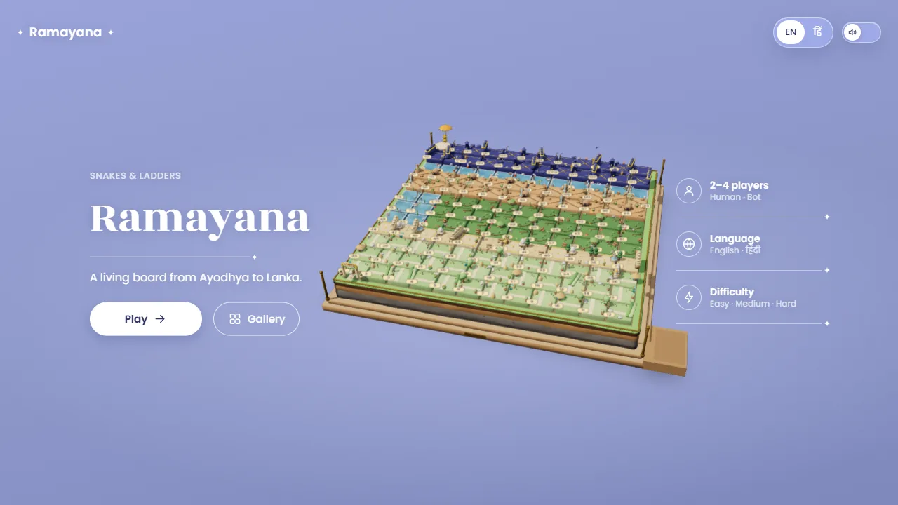

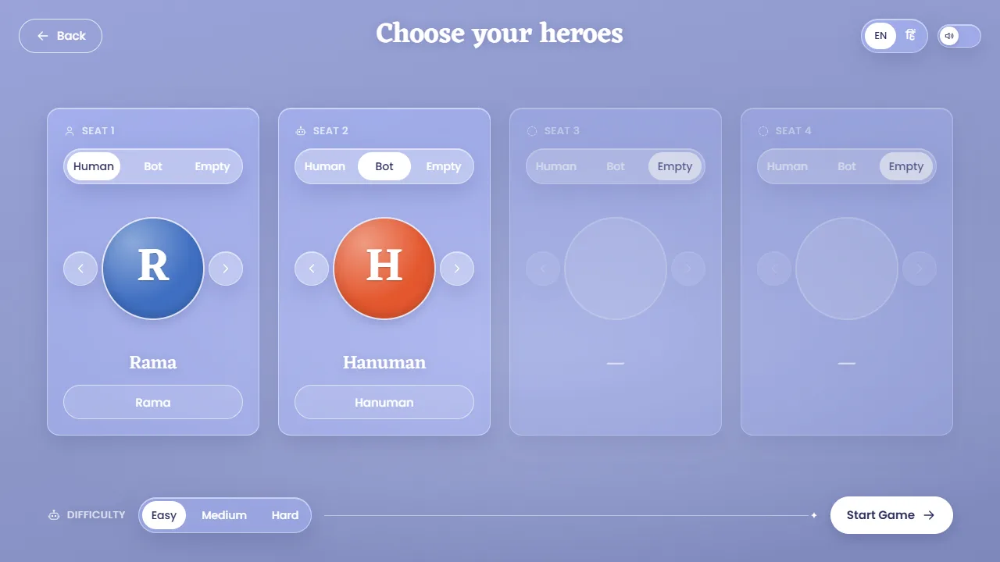

### Game at Fit — desktop 1280x720 and phone 844x390

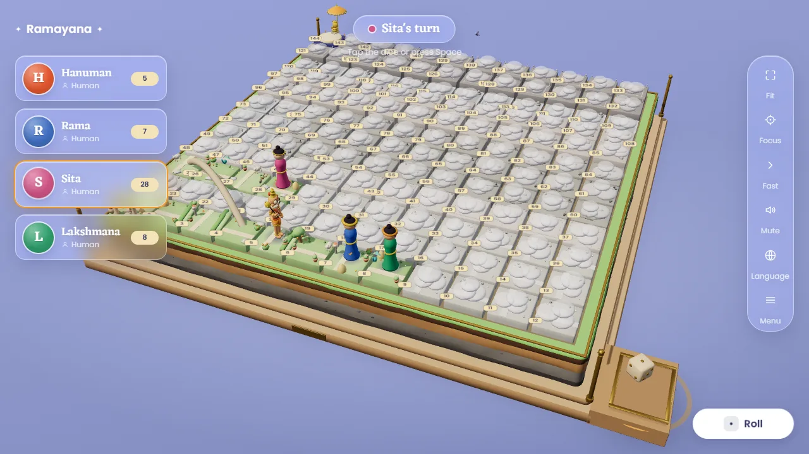

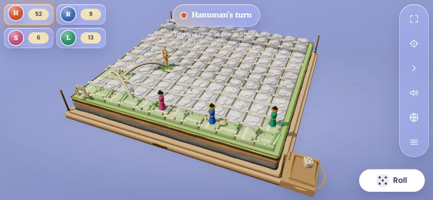

### Close orbit over three regions (fog lifted for the review)

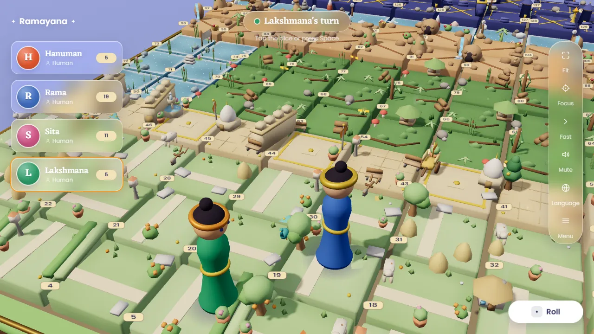

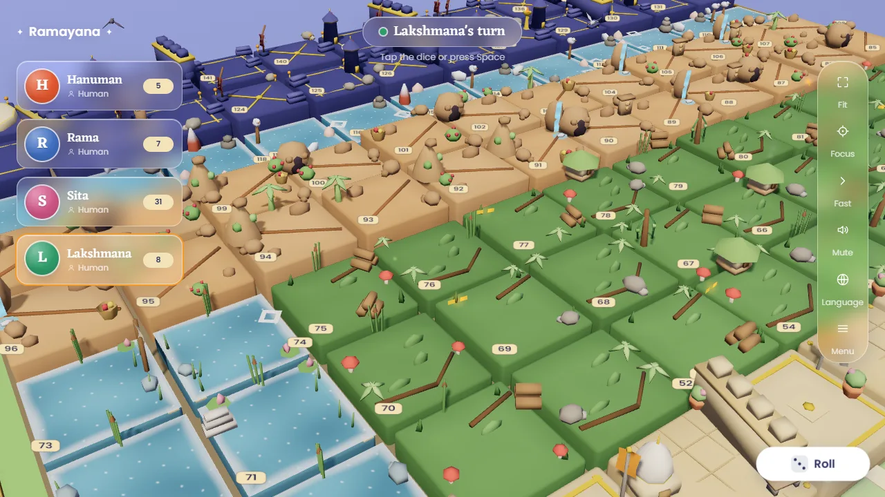

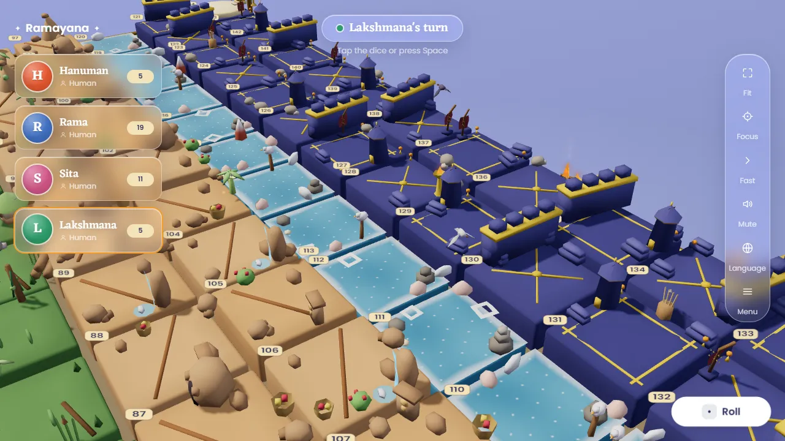

### Hanuman running mid-move (5 squares, the run clip locked to distance)

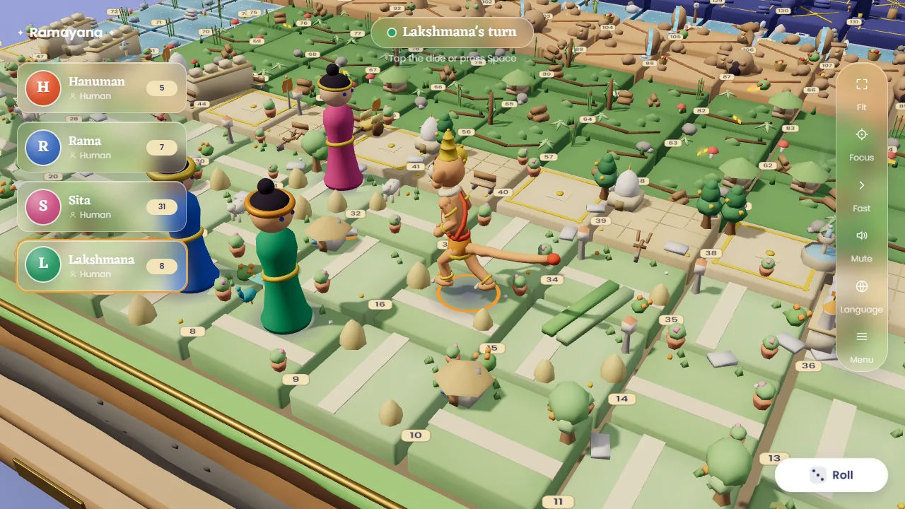

### Hanuman's leap to Lanka onto the bridge placeholder (95 → 122, mid-flight)

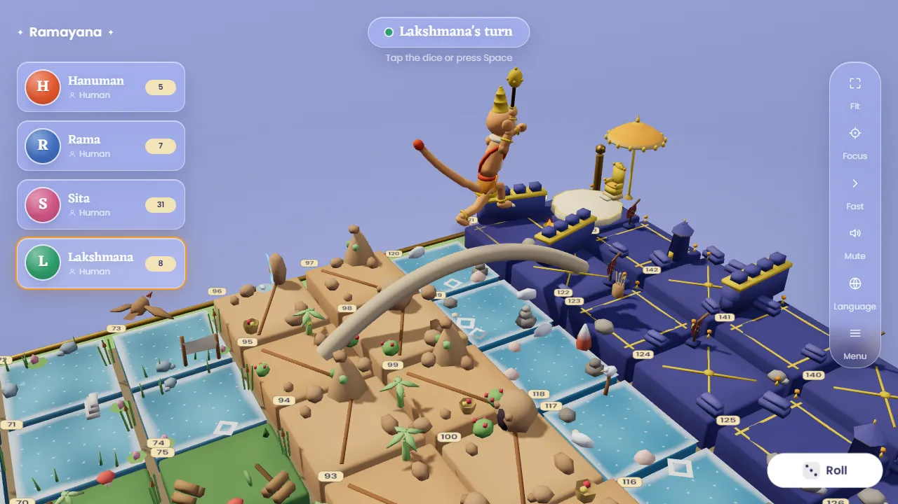

### Snake bite placeholder (kaikeyi 46 → 28: Hanuman scared, shrinking into the head)

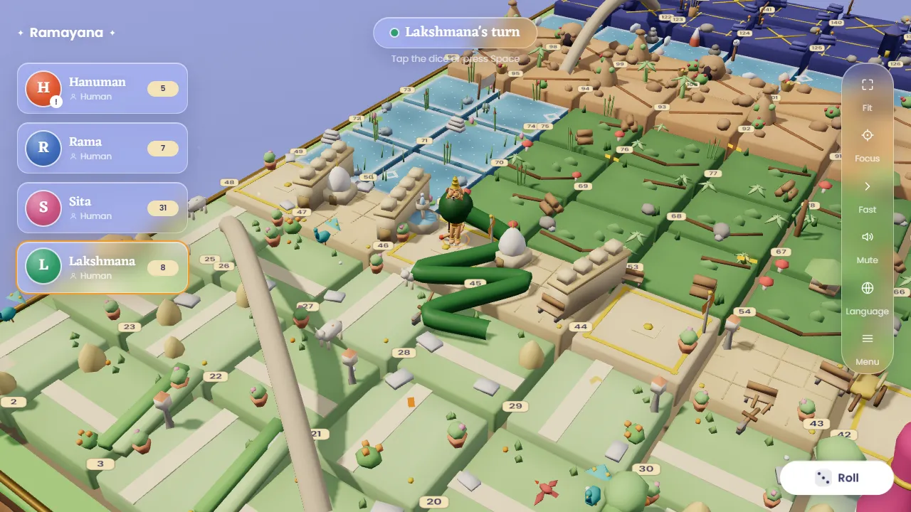

### The die rolling on the tray, and the tray waiting for a human roll

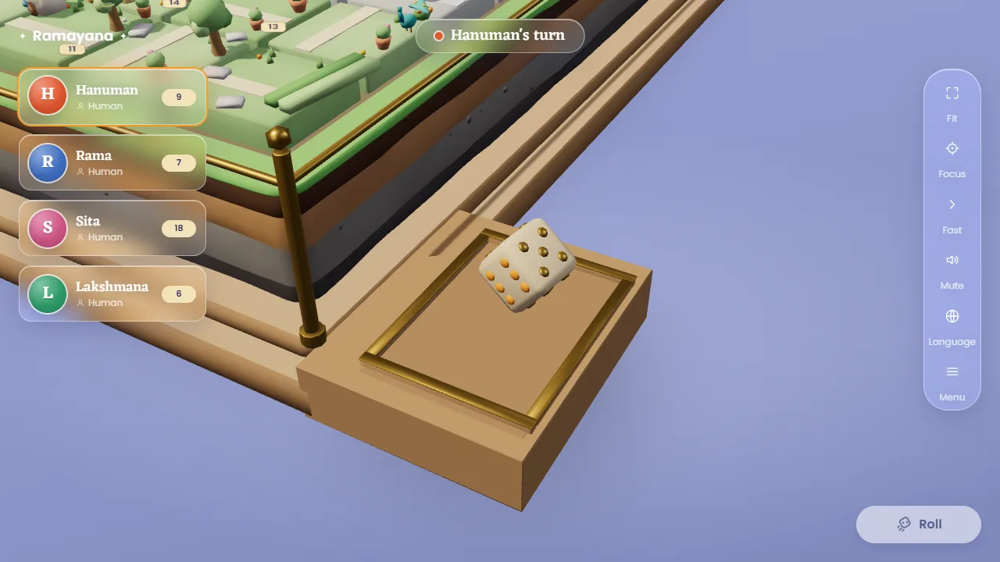

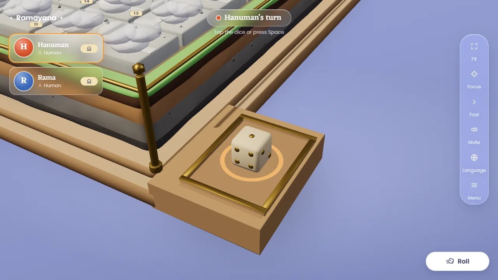

### Speech bubble over a token

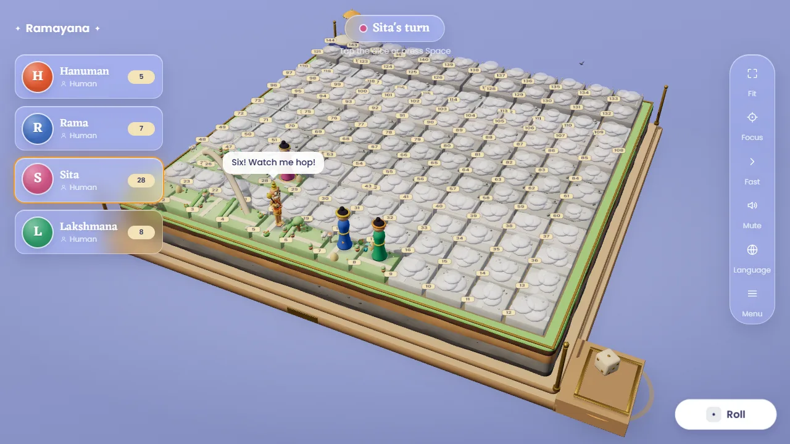

### Fog boundary

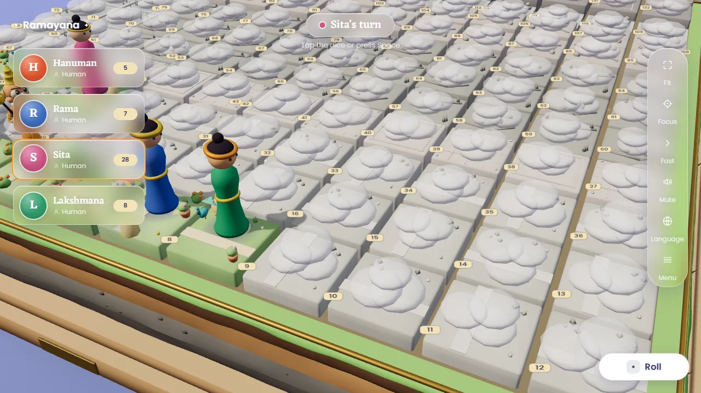

### Win (Easy, 4 bots, normal speed: Hanuman wins)

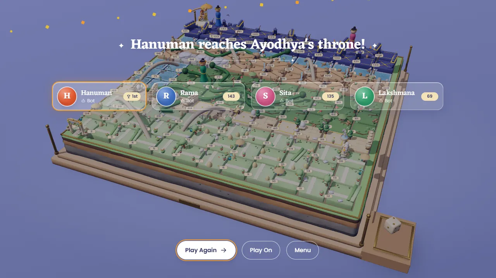

## Metrics

Measured from the production build (`vite preview`) in headless Edge with `__app.metrics()`. Setup: Hard board, 4 bots
(Hanuman plus 3 pegs), sampled every second for 25 s, then 6 s with every block revealed. The draw-call total is one
frame and includes the shadow pass. Shadow calls are the visible shadow casters (one directional light). No snakes or
bridges were raised: they are placeholders and are not counted against their own budgets yet.

| Metric | Desktop 1280x720 | Phone 844x390 | Budget (spec 10) |
|---|---|---|---|
| Frame rate, headless | 60 min / 60 avg | 59.8 min / 60 avg | ≥ 24 headless; ≥ 45 real phone (not measured) |
| Draw calls, main pass | 86 | 86 | ≤ 180 / ≤ 150 |
| Draw calls, shadow pass | 44 | 42 | ≤ 60 / ≤ 50 |
| Triangles per frame (both passes) | 143 k | 141 k | ≤ 500 k / ≤ 350 k |
| GPU textures (count) | 13 | 13 | ≤ 8 MB |
| `npm run devices` | 5 profiles OK; laptop, iPads and phone at 58–60 fps | | ≥ 24 fps |

Download sizes from `dist/` (JS and CSS brotli; fonts and GLBs at file size, since woff2 and meshopt are already
compressed):

| Asset | Size | Budget |
|---|---|---|
| JS (main + Hero + three chunks) | 297 KB br | ≤ 380 KB |
| Fonts (6 woff2) | 351 KB | ≤ 420 KB |
| board.glb | 246 KB | ≤ 300 KB |
| props.glb | 138 KB | ≤ 450 KB |
| landmarks.glb | 51 KB | ≤ 400 KB |
| hanuman.glb | 171 KB | ≤ 380 KB |
| die.glb | 24 KB | (in the board budget) |
| First interactive (JS + CSS + fonts + board + die + props + landmarks + Hanuman) | ≈ 1.3 MB | ≤ 2.6 MB |

## Full games

All on the production build, with zero console errors and zero page errors.

| Game | Speed | Winner | Time |
|---|---|---|---|
| Easy, 4 bots (Hanuman, Rama, Sita, Lakshmana) | Normal | Hanuman | 461 s |
| Hard, 4 bots | Fast | Rama | 147 s |
| Easy, 4 bots, `prefers-reduced-motion: reduce` | Fast | Hanuman | 149 s |

Also green: `npm run verify` (lint, 626 Vitest tests, sim, build, smoke on :4173) and `npm run devices`.

## Known gaps for the owner

| # | Gap | Where it goes |
|---|---|---|
| 1 | Rama, Sita and Lakshmana are clay pegs; snakes and bridges are tubes. Hanuman's deck crossing follows the placeholder arch. | T44.9–T44.13 |
| 2 | **Chhatra at 144 vs. tall heroes.** The canopy is 0.79 u high, but a hero is 1.43 u tall. From the default camera, the parasol reads beside or just above the winner's head on 144 (see Win). This is a respect risk (R6: no halo reading). Raise the pole above 1.6 u or move it further back. | Owner decision, then the landmarks owner |
| 3 | At Fit with 3–4 seats, the glass seat-card column covers the board's front-left corner (squares 1–3 and the gate), visible through the glass. A bigger Fit shift would push the tray under the Roll pill. | Owner: accept, or shrink the cards on desktop |
| 4 | Deviations from spec 1.3 / 3 / 2.4, made for the look: key light front-left at 3.0, environment 0.12, exposure 0.85; flattened mist; props scaled past the 22 px cap (new cap 0.5 u) plus 2 dressing pieces per block. | Owner sign-off; then update the spec |
| 5 | Shadow pass is 42–51 calls before any snake or bridge is raised. That is at the phone budget (≤ 50). | T44.14: stop small props casting on phone, or cap landmark casters |
| 6 | Fast 4-bot Hard game takes ~147 s. T44.1's ≤ 60 s was measured on the capsule placeholder. Bot delay, reactions and the die tumble (0.4 s Fast) dominate. | T44.14 if it matters |
| 7 | The tray's indigo felt (die.glb) does not show: the board ledge's tan well floor covers it. The two trays overlap. | Board / dice owner: drop one of the two trays |
| 8 | Not built: block-tap label (2.8), the 3D emote glyph over the head (4.7). A tap on the board no longer rolls (the die and tray, the Roll pill and Space/Enter do). | T44.14 |
| 9 | `__app.metrics()` reports a texture count, not `textureMb` / `bytesLoaded` (spec 11.3). | T44.14 (budgets in smoke) |
| 10 | Real-phone fps (≥ 45) not measured: headless only. | T44.14 |
| 11 | Under reduced motion the winner plays `happy` instead of the `cheer` somersault. Peg figures don't animate a leap beyond the arc. | By design / T44.9–11 |
| 12 | The review capture steps use dev-only hooks (`__board.view`, `/src` imports). They live in `screenshots-tmp/t448/` and are not committed. | Port into `scripts/screenshots.mjs` in T44.14 |
